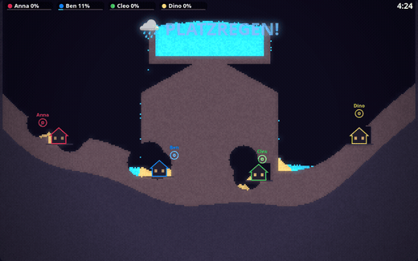
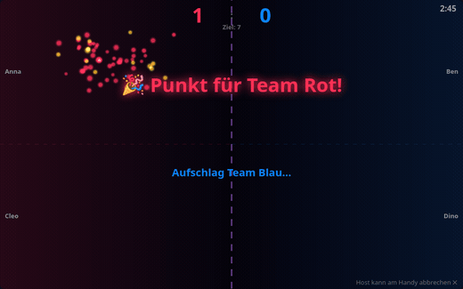
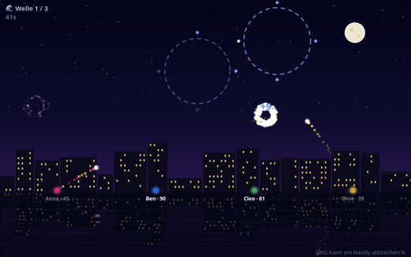
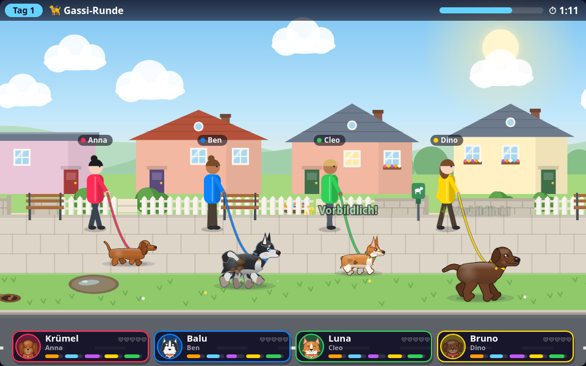

# 🎉 Party Hub


**Couch party games on your TV — every phone is a controller.** One command starts a local
server; a TV (or laptop) shows the big screen, and everyone joins from their phone browser
over Wi-Fi. No apps, no accounts, no internet required.

Inspired by AirConsole, built from scratch: a tiny WebSocket relay, a vanilla-JS game shell,
and **19 games** — from social deduction and drawing chains to real-3D racing, co-op
bullet-hell boss fights, a falling-sand flood war and a flat-share full of dogs.

## Screenshots

| | |
|---|---|
|  |  |
| 🌊 Sintflut — falling-sand flood war | ☄️ Kometen-Klatsche — swipe volleyball |
|  |  |
| 🎆 Himmelszünder — synchronized fireworks | 🐉 Boss Raid — co-op neon bullet-hell |
|  |  |
| 💥 Artillery Hills — Worms-style tanks | 🐶 Wauwau-WG — dog care in a shared flat |

...plus a real-3D racer (three.js), the BREACH tactical shooter and 11 more. The GIFs are
captured straight from the dev harnesses (`?sim=…&seed=…&freeze=1` + headless Firefox +
ffmpeg) — no phones were harmed.

## Quick start

Requirements: [Node.js](https://nodejs.org) 18+ and a Wi-Fi network shared by the TV and the phones.

```bash
npm install
npm start
```

The server prints its links with your LAN address. The easiest way in is
`http://<your-ip>:3000/` on every device: the TV / laptop taps **📺 Ich bin der
Bildschirm**, every phone taps **📱 Mitspielen** (or scans the QR code in the lobby). There
is only one screen per server — a second one takes over the first. Or go direct:

- **Screen** (open on the TV / laptop): `http://<your-ip>:3000/screen.html`
- **Controller** (open on every phone): `http://<your-ip>:3000/controller.html`

Players type a name, the first player becomes the host, picks a game and its settings in
the lobby, and hits START. Phones reconnect automatically after screen locks or Wi-Fi
hiccups, and keep their identity.

**Playing online / second room:** one device runs the screen, everyone else opens
**👀 Mitschauen** (`/view.html`, a live mirror of the screen) and plays with their phone.
Host the server on Render for rounds across homes — see [Playing online](docs/ONLINE.md).

## The games

| Game | Players | What it is |
|---|---|---|
| 🏍️ Light Cycles | 2+ | Tron-style light-cycle duel |
| 🐍 Slither | 1+ | Snake arena with boost |
| 🎨 Drawing Evolution | 2+ | Telephone-game drawing chains with a recap show |
| 📍 Geo-Pin | 1+ | Pin world locations on a map, closest wins |
| 🕵️ Spion | 3+ | Social deduction — one player doesn't know the word |
| 🖌️ Fake Artist | 3+ | Everyone draws one stroke; one is faking it |
| ⚡ Reaktionsduell | 2+ | Fastest tap when the screen turns green |
| 🏙️ Stadt Land Fluss | 2+ | Scattergories with custom categories |
| 💥 Artillery Hills | 2+ | Worms-style tank duels: biomes, wind, supply drops, special weapons |
| 💎 Bumper Gems | 2+ | Physics bumper arena — collect gems, shove friends |
| 🏎️ Micro Racer | 2+ | Real-3D elimination racing (three.js): nitro, ramps, three dioramas |
| 🐉 Boss Raid | 1+ | Co-op neon bullet-hell against three bosses, with classes and revives |
| 🚀 Space Arena | 2+ | Asteroids dogfight around a growing black hole |
| 🌊 Sintflut | 2+ | Falling-sand flood war: dam, dig, blast — last dry house wins |
| ☄️ Kometen-Klatsche | 2+ | Team volleyball with a burning comet — swipe to return |
| 🧪 Hexenschicht | 3+ | Co-op witch kitchen: throw ingredients from phone to phone |
| 🎆 Himmelszünder | 1+ | Fireworks show with beat targets and sync combos |
| 🎯 BREACH · Station NEXUS | 1–8 | Original 3D tactical FPS: phone-controlled split-screen, private online rooms, bots, two bomb sites |
| 🐶 Wauwau-WG | 1+ | Nintendogs-style dog care: pet, bathe, walk and play fetch — your dog lives on your phone |

Game UI is in **German** (it's a living-room game night thing) — contributions keep that
convention, docs are in English.

## BREACH — Station NEXUS

An original sci-fi tactical FPS with ten weapons, automatic reloads, headshots, smoke, bot navigation,
two bomb sites and short team rounds. It uses the bundled three.js; all map geometry,
operator models and audio are procedural. There are no remote assets or new dependencies.

**Two phones + one laptop (same Wi-Fi):** Start `npm start`, open `/screen.html` on the
laptop, and scan its QR code with both phones (or open the printed LAN controller URL).
Enter two different names, select **🎯 BREACH · Station NEXUS**, then START on the host
phone. Player 1 sees the upper view; player 2 sees the lower view. Move with the left
thumb area, swipe the right area to aim, hold and drag FEUER to shoot while aiming, and hold
E / ZIEL while standing on A or B to plant. Both players fight together against bots.
Empty magazines reload automatically; LADEN also reloads manually. Tap the weapon name
to open the ten-weapon arsenal at any time. STEUERUNG saves sensitivity, left-handed
layout and optional co-op aim assistance on each phone. Landscape with two thumbs is
recommended; portrait is also supported. Phones need no installation and do not render 3D.
The default Entspannt mode has slower bots, extra co-op armor and health recovery after
six seconds without damage. Human PvP stats remain equal and have no aim assistance.

Choose from six modes before START: **Bombenmission**, **Team-Deathmatch**, **Free for All**,
**Waffenrennen** (team kills unlock all ten weapons), **Zonenkontrolle** (capture A/B,
first to 60 points), and **Überleben** (five increasingly strong cooperative waves).
Weapon race and zone control have three-second respawns. Survival restores fallen
teammates and supplies between waves. Weapon race automatically chooses your weapon;
the other modes keep the full arsenal. All modes also work in solo and online rooms.

**Free for All + quickscope:** Everyone fights everyone, including bots. First to 15
kills wins, or most kills after three minutes; tied kills draw. Respawn after three
seconds with brief protection. Choose all ten weapons freely and optionally disable
bot fill for a friends-only duel. With MR-9 or Longbow, tap **QUICK SCOPE** on the phone
to briefly aim and fire once. On PC, quickly aim with right click and shoot with left
click. Scoped kills within 350 ms count as QS in the scoreboard. The Longbow's scoped
body shot defeats a full-health, 40-armor opponent within its effective range.

**Independent screens / online PvP:** Open `/breach.html`, enter a callsign and create
a room. Copy the invite link or share its five-character code. Friends open the same
server URL, join, and choose attack or defence. The host controls mode, bot fill,
difficulty and match length. Each browser gets its own first-person view; the server
owns movement, damage and round state. Late joiners spectate until the next match.
Without bot fill, team modes need at least one player per team; FFA needs two players
without team selection. Survival puts
all friends on one team against the station's guards. A departing host transfers
ownership automatically. Empty rooms are removed.

On a PC: WASD move, mouse aim, left click fire, right click aim down sights, R reload,
G smoke, Space jump, Shift walk quietly, E hold to plant/defuse, Tab scoreboard.
Choose weapons with 1–0 at any time or open ARSENAL. Esc opens the menu; online rounds keep
running. Mobile independent-screen play also has touch controls.

LAN links work on the local network. Playing from different networks requires hosting
this Node server at an Internet-reachable address with WebSocket support. No public
deployment or tunnelling is created automatically. Prefer HTTPS/WSS behind a reverse
proxy. The game is a private-room prototype, not a ranked matchmaking service.

`npm run test:breach` runs deterministic gameplay checks and a real two-client WebSocket
integration test, plus pointer ownership and short-tap regressions. `/dev-breach.html?split=1&sim=6000&freeze=1` is the split-screen
development harness; `?overview=1` shows the complete map. See [BREACH notes](docs/BREACH.md).

## Wauwau-WG

A cozy Nintendogs-style game: every player adopts a dog, and the TV is the shared flat
("WG"), street and park where all dogs live together. Your phone shows *your* dog up close
— pet it (every dog has a favorite spot), brush and feed it, give it a three-step foam
bath, walk it on a leash, throw its toys and shop with the Taler it earns.

One round is one day: **☀️ Morgen** in the flat (care and shopping) → **🦮 Gassi** down a
scrolling street (dig at sniff spots for loot, dodge mud puddles, pick up after your dog,
call it back from a cat) → **🎾 Park** (swipe to throw ball, frisbee, duck or stick; dogs
catch in the air and steal each other's toys) → **🌙 Feierabend**: the day's summary crowns
the "Hund des Tages" for the evening scoreboard, and the host starts the next day. The
lobby setting **Tageslänge** picks Kurz, Normal or Lang (about 3, 5 or 8 minutes a day).

Your dog lives on your phone (browser storage, one slot per player name) and comes back
next game night with its love, toys and Taler — needs only change while you play, so
nobody starves between evenings. The TV keeps a backup by player name and offers it to a
phone that arrives without one ("Willkommen zurück! 👋"). Latecomers can join at any time
and adopt or bring their dog straight into the current scene.

`npm run test:wauwauwg` runs the rules/protocol test and a JSDOM end-to-end test through
the real phone UI. `/dev-wauwauwg.html?phase=walk&sim=20000&freeze=1` is the TV harness
with bot dogs; `/dev-wauwauwg-phone.html?view=home` runs the phone UI against a fake
screen. See the [Wauwau-WG design notes](docs/WAUWAUWG.md).

## How it works

```
┌──────────┐   WebSocket relay    ┌──────────────┐
│ Phone(s) │ ◄──────────────────► │  server.js   │  ← small: static files +
│controller│                      │ (id routing) │    message routing, no game logic
└──────────┘                      └──────┬───────┘
                                         │
                                  ┌──────▼───────┐
                                  │  screen.html │  ← lobby shell + shared canvas,
                                  │  (the TV)    │    runs the active game module
                                  └──────────────┘
```

- **`server.js`** — serves `public/` (with a small landing page at `/`) and relays JSON
  messages between devices. The relay knows nothing about games (BREACH's online rooms
  live separately in `breach-server.js`).
- **`public/screen.html` / `public/controller.html`** — the shell: lobby, player names,
  host logic, settings UI, and a registry that routes messages to the active game.
- **`public/games/<key>/`** — one folder per game: `meta.js` (label, min players,
  declarative settings), `screen.js` (game logic + rendering), `controller.js`
  (phone UI). Games are self-contained; the shell provides a small, documented API.

## Build your own game 🛠️

That's the whole point! Start here:

1. Read **[public/games/README.md](public/games/README.md)** — the game developer guide
   with the full shell API reference.
2. Copy **[public/games/_template/](public/games/_template/)** — a fully commented,
   working example game.
3. See **[CONTRIBUTING.md](CONTRIBUTING.md)** for the checklist and PR flow.

A minimal game is ~100 lines. A fancy one is ~600–900. Everything is vanilla JS with no
build step — edit, reload, play.

## Testing

```bash
npm test
```

Runs JSDOM end-to-end tests that boot the real screen and controller pages against an
in-process fake of the server bus. Each game also ships a `public/dev-<key>.html` harness
that runs it standalone with bots and a fake clock — great for screenshots and tuning.

## License

[MIT](LICENSE). The vendored [three.js](public/vendor/THREE-LICENSE) is MIT as well.
