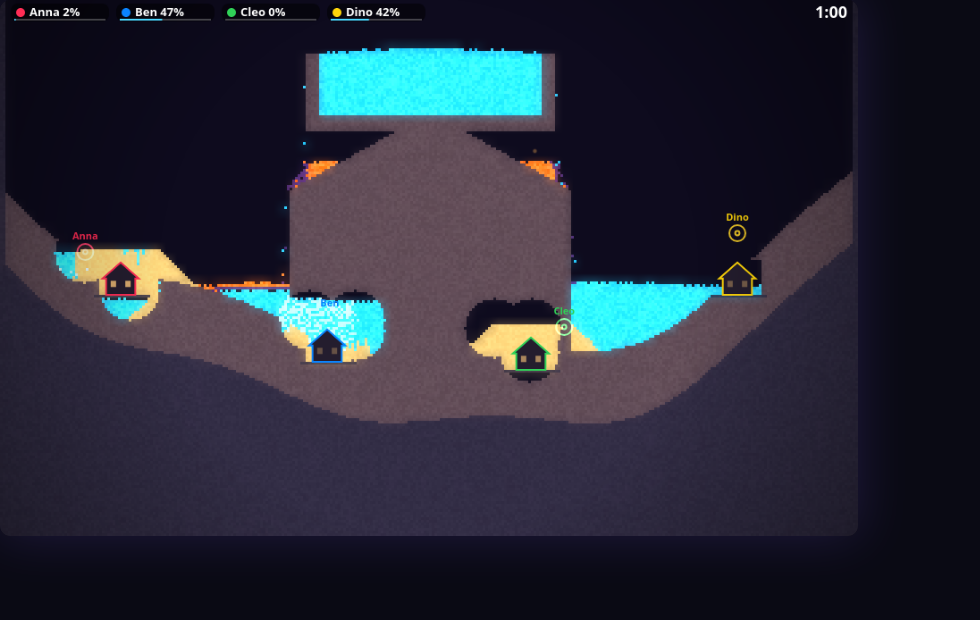
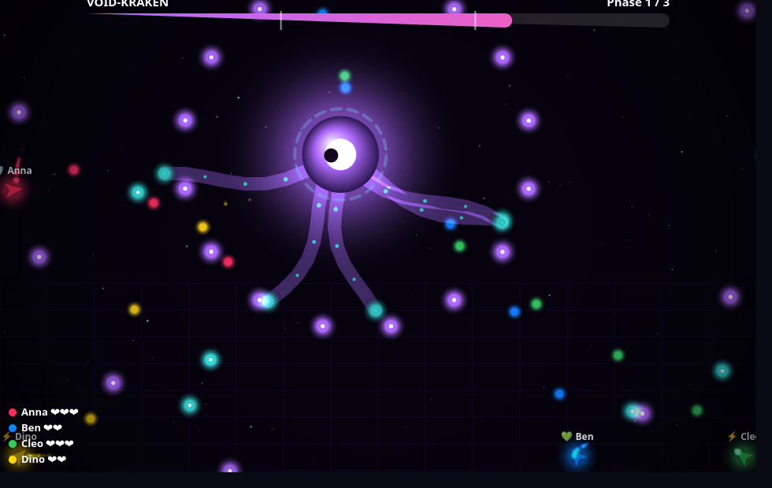
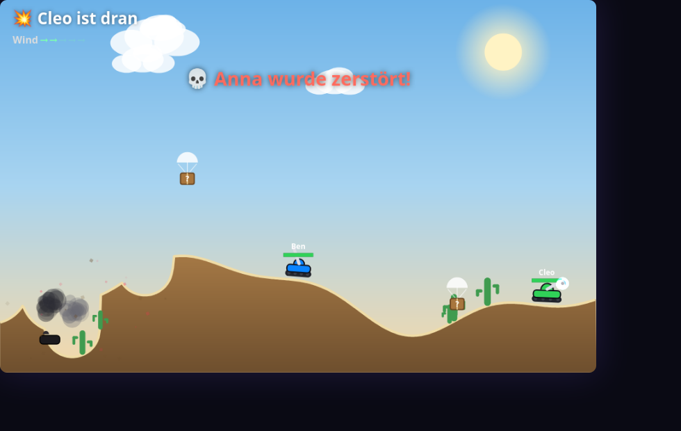
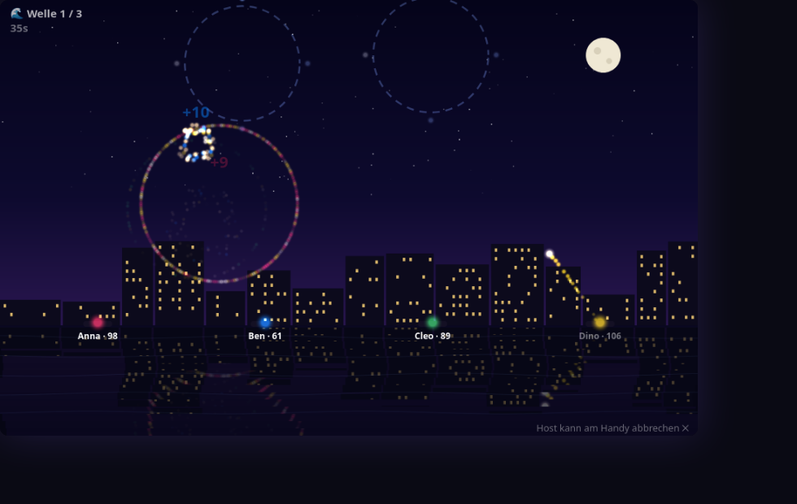
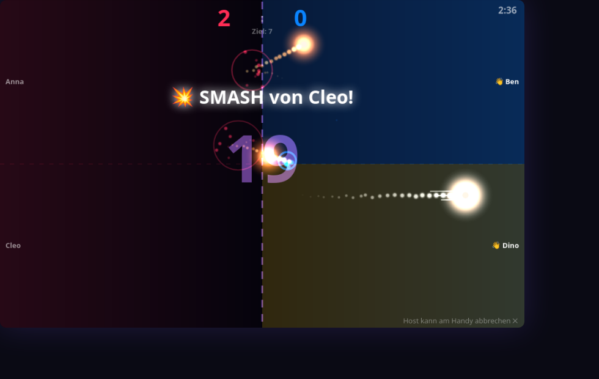

# 🎉 Party Hub


**Couch party games on your TV — every phone is a controller.** One command starts a local
server; a TV (or laptop) shows the big screen, and everyone joins from their phone browser
over Wi-Fi. No apps, no accounts, no internet required.

Inspired by AirConsole, built from scratch: a tiny WebSocket relay, a vanilla-JS game shell,
and **17 games** — from social deduction and drawing chains to real-3D racing, co-op
bullet-hell boss fights and a falling-sand flood war.

## Screenshots

| | |
|---|---|
|  |  |
| 🌊 Sintflut — falling-sand flood war | 🐉 Boss Raid — co-op neon bullet-hell |
|  |  |
| 💥 Artillery Hills — Worms-style tanks | 🎆 Himmelszünder — synchronized fireworks |
|  | |
| ☄️ Kometen-Klatsche — swipe volleyball | ...and a real-3D racer (three.js), and 12 more |

## Quick start

Requirements: [Node.js](https://nodejs.org) 18+ and a Wi-Fi network shared by the TV and the phones.

```bash
npm install
npm start
```

The server prints two URLs:

- **Screen** (open on the TV / laptop): `http://<your-ip>:3000/screen.html`
- **Controller** (open on every phone): `http://<your-ip>:3000/controller.html`

Players type a name, the first player becomes the host, picks a game and its settings in
the lobby, and hits START. Phones reconnect automatically after screen locks or Wi-Fi
hiccups, and keep their identity.

## The games

| Game | Players | What it is |
|---|---|---|
| 🏍️ Light Cycles | 2+ | Tron-style light-cycle duel |
| 🐍 Slither | 1+ | Snake arena with boost |
| 🎨 Drawing Evolution | 2+ | Telephone-game drawing chains with a recap show |
| 📍 Geo-Pin | 1+ | Pin world locations on a map, closest wins |
| 🕵️ Spion | 3+ | Social deduction — one player doesn't know the word |
| 🖌️ Fake Artist | 3+ | Everyone draws one stroke; one is faking it |
| ⚡ Reaktionsduell | 2+ | Fastest tap when the screen turns green |
| 🏙️ Stadt Land Fluss | 2+ | Scattergories with custom categories |
| 💥 Artillery Hills | 2+ | Worms-style tank duels: biomes, wind, supply drops, special weapons |
| 💎 Bumper Gems | 2+ | Physics bumper arena — collect gems, shove friends |
| 🏎️ Micro Racer | 2+ | Real-3D elimination racing (three.js): nitro, ramps, three dioramas |
| 🐉 Boss Raid | 1+ | Co-op neon bullet-hell against three bosses, with classes and revives |
| 🚀 Space Arena | 2+ | Asteroids dogfight around a growing black hole |
| 🌊 Sintflut | 2+ | Falling-sand flood war: dam, dig, blast — last dry house wins |
| ☄️ Kometen-Klatsche | 2+ | Team volleyball with a burning comet — swipe to return |
| 🧪 Hexenschicht | 3+ | Co-op witch kitchen: throw ingredients from phone to phone |
| 🎆 Himmelszünder | 1+ | Fireworks show with beat targets and sync combos |

Game UI is in **German** (it's a living-room game night thing) — contributions keep that
convention, docs are in English.

## How it works

```
┌──────────┐   WebSocket relay    ┌──────────────┐
│ Phone(s) │ ◄──────────────────► │  server.js   │  ← ~90 lines: static files +
│controller│                      │ (id routing) │    message routing, no game logic
└──────────┘                      └──────┬───────┘
                                         │
                                  ┌──────▼───────┐
                                  │  screen.html │  ← lobby shell + shared canvas,
                                  │  (the TV)    │    runs the active game module
                                  └──────────────┘
```

- **`server.js`** — serves `public/` and relays JSON messages between devices. It knows
  nothing about games.
- **`public/screen.html` / `public/controller.html`** — the shell: lobby, player names,
  host logic, settings UI, and a registry that routes messages to the active game.
- **`public/games/<key>/`** — one folder per game: `meta.js` (label, min players,
  declarative settings), `screen.js` (game logic + rendering), `controller.js`
  (phone UI). Games are self-contained; the shell provides a small, documented API.

## Build your own game 🛠️

That's the whole point! Start here:

1. Read **[public/games/README.md](public/games/README.md)** — the game developer guide
   with the full shell API reference.
2. Copy **[public/games/_template/](public/games/_template/)** — a fully commented,
   working example game.
3. See **[CONTRIBUTING.md](CONTRIBUTING.md)** for the checklist and PR flow.

A minimal game is ~100 lines. A fancy one is ~600–900. Everything is vanilla JS with no
build step — edit, reload, play.

## Testing

```bash
npm test
```

Runs JSDOM end-to-end tests that boot the real screen and controller pages against an
in-process fake of the server bus. Each game also ships a `public/dev-<key>.html` harness
that runs it standalone with bots and a fake clock — great for screenshots and tuning.

## License

[MIT](LICENSE). The vendored [three.js](public/vendor/THREE-LICENSE) is MIT as well.
