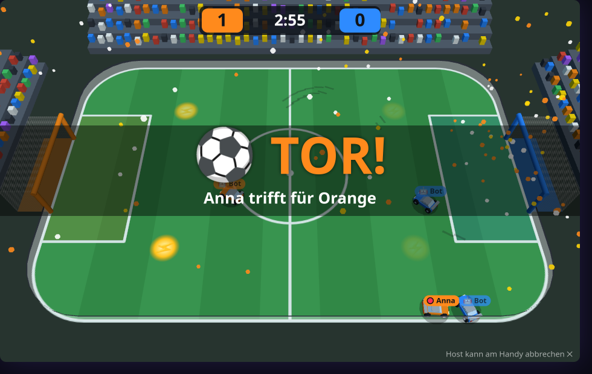

# ⚽ Autoball — design notes

Car football in 3D with the cars from Micro Racer. Two teams (🟠 Orange, 🔵 Blau), one big
ball, a small pitch with boards. More goals when the clock runs out wins; a draw goes to a
golden goal. 1+ phones: bots fill the teams up.

This file is the contract between the modules. If you change a shape or a rule here,
change it in the code and in the tests too.

## Files

| File | Loaded by | Owns |
|---|---|---|
| `public/core/kit3d.js` | screen | shared with Micro Racer: the car, particles, skid marks, the canvas stage |
| `public/games/autoball/meta.js` | screen + controller | key, label, settings |
| `public/games/autoball/sim.js` | screen (+ Node tests) | pitch, driving, ball, goals, match flow, bots → `window.AutoballSim` |
| `public/games/autoball/render.js` | screen | three.js stadium, cars, ball, effects → `window.AutoballView` |
| `public/games/autoball/screen.js` | screen | glue: team selection, phone protocol, HUD, sound |
| `public/games/autoball/controller.js` | controller | team selection, thumb stick, boost |
| `public/dev-autoball.html` | — | TV harness, bots drive (`?arena=…&sim=<ms>&teams=1&goal=1&over=1`) |
| `test-autoball.js` | Node | rule tests against `sim.js` |
| `test-autoball-flow.js` | Node/JSDOM | shell + phones end to end with a stub view |

`sim.js` has no three.js and no DOM. It runs in fixed ticks of 1/120 s and takes everything
random from one seed, so a match replays exactly in the tests.

## Before the kickoff: teams

The game starts in a team selection, drawn on the shell canvas. Players are dealt out in
turn and can switch on the phone; the host kicks off. With *Bots: Füllen auf* bots bring
the smaller team up to the size of the larger one (and fill an empty team). Without bots
both teams need at least one car. A rematch goes back to the team selection.

## Driving

The camera stands still above the pitch, so the phone's stick means **"this way on the
TV"**: the car turns towards it and drives; the further the thumb, the faster. Letting go
brakes. A slow car turns almost on the spot, a fast one needs room.

Boost: +55 % speed while the tank lasts (1.6 s full). It refills by itself in 8 s and at
once on one of the four boost pads (each comes back after 7 s).

## Ball and goals

- The ball has real height: a hard hit lifts it, it can fly over cars and come back off
  the crossbar. Cars stay on the ground. Against the ball a car is a capsule, so a hit
  with the nose is not the same as a hit with the side.
- Team 0 (Orange) defends the goal at −x. A ball behind the line under the crossbar is a
  goal for the other team.
- Scorer: the last attacker who touched the ball. Only when that is more than 4 s ago
  (or never happened) and a defender touched it last is it an own goal.
- After a goal the ball bursts and throws nearby cars away; 3 s later there is a new kickoff.
- A ball that does not get away for 8 s (wedged in a corner, pinned between cars) is
  dropped from above at the centre.

## Match flow

`kickoff` (countdown, cars frozen) → `play` (the clock runs) → `goal` → `kickoff` … →
`over`. When the clock reaches 0 with a draw, play goes on without a clock until the next
goal (golden goal).

## People come and go

- A player leaves mid-match: a bot drives their car on.
- A player joins mid-match: they go to the team with fewer players and take over a bot's
  car there, or get a new car if there is no bot.
- The match ends early only when no player is left.

## Phone protocol

| Direction | Message | Meaning |
|---|---|---|
| phone → TV | `abHello` | sent on activate: "tell me where we are" |
| | `abTeam` | switch team (team selection only) |
| | `abStart`, `abAgain` | host only: kick off / back to the team selection after a match |
| | `abStick { x, y }` | stick, each -1..1, y down = down the TV |
| | `abBoost { on }` | boost held or released |
| TV → phone | `abTeams { team, color, host, canStart, lists }` | team selection |
| | `abState { phase, team, color, roof, score, golden, won, host, text }` | on every phase change |
| | `abYou { tank }` | boost tank 0..1, a few times a second |

## Picture

Cars are painted in the team colour; roof and wing carry the player's own colour, and a
name tag floats above. A ring under the ball shows which team touched it last. Three
arenas: Stadion, Eishalle (little grip, the ball slides on), Neon.

## Tunables

All numbers sit at the top of `sim.js` and are guesses until real people have played:
pitch size, speeds, ball weight, lift, boost, bot strength.
