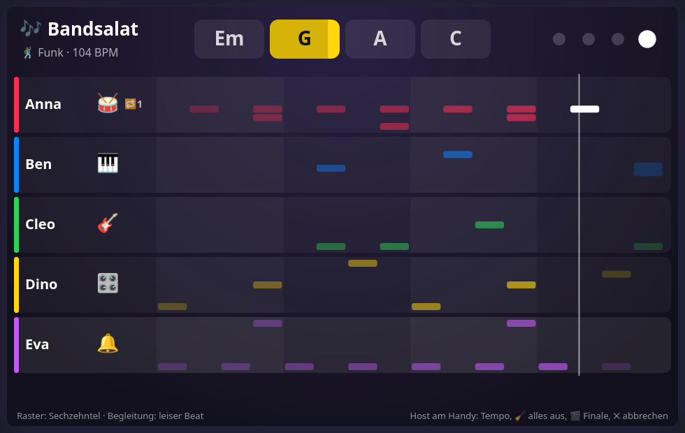

# 🎶 Bandsalat — design notes

A jam session: every phone is an instrument, the TV is the sound system, everybody plays one
song together. No winner, no skill needed, 1+ phones, latecomers join at any time.

This file is the contract between the modules. If you change a shape or a rule here,
change it in the code and in the tests too.

## Why it sounds like music

Two things break a game like this, and the design is built around them.

**Delay.** Finger → Wi-Fi → TV → speakers: the sound comes audibly after the tap. So the TV
keeps a bar clock and puts every note on the nearest grid line (sixteenths by default,
eighths or off in the settings). A tap is assumed to have happened `COMP` (40 ms) before it
arrives. If the nearest line is still ahead, the note waits for it; if it is already over,
the note plays at once. Who taps roughly in time sounds exactly in time, and nobody waits
longer than half a step.

**Wrong notes.** The style fixes a five-note scale and a round of four chords, one per bar.
The keyboard only has notes of the scale. Bass and patterns follow the current chord by
themselves. There is no wrong note to hit.

## Files

| File | Loaded by | Owns |
|---|---|---|
| `public/core/sfx.js` | screen | `sfx.audio()` hands out the shared AudioContext and master, so 🔊 and the autoplay unlock apply here too |
| `public/games/bandsalat/meta.js` | screen + controller | key, label, settings (style, grid, backing) |
| `public/games/bandsalat/music.js` | screen (+ Node tests) | styles, scales, chords, the bar clock, the grid, loops, step patterns, finale → `window.BandMusic` |
| `public/games/bandsalat/synth.js` | screen | every sound from oscillators and noise, compressor, voice limit → `window.BandSynth` |
| `public/games/bandsalat/screen.js` | screen | glue: phone protocol, the clock in `render()`, the stage |
| `public/games/bandsalat/controller.js` | controller | instrument picker, pads, step grid, looper, host box |
| `public/dev-bandsalat.html` | — | TV harness with a bot band; `?phone=keys` adds the real phone UI on the same page |
| `test-bandsalat.js` | Node | rule tests against `music.js` |
| `test-bandsalat-flow.js` | Node/JSDOM | shell + phones end to end with a fake AudioContext |

`music.js` has no DOM and no sound. Time comes in from outside in seconds, so the tests run
a whole song in a loop. The band's clock is `performance.now()`; `screen.js` converts each
note's time to AudioContext time when it hands it to the synth.

## Time

- A **step** is a sixteenth, 16 steps are a bar, the chords go round every 4 bars.
- `band.advance(t, ahead)` is called every frame. It returns the notes of loops, patterns
  and backing that fall due within the next `ahead` seconds (120 ms), so the synth can
  schedule them sample-exactly. Live notes come from `band.noteOn()` in `onMessage`, not
  from the frame loop.
- Styles can swing: odd steps come `swing` × one step late.
- A tempo change re-anchors the clock, the step count does not jump.
- If more than four bars pass between two frames (the tab slept), the gap is skipped.

## Instruments

| Key | Phone | Notes |
|---|---|---|
| `drums` | 6 pads | one-shots: kick, snare, hat, open hat, tom, crash |
| `keys` | 10 keys (two rows upright, one row sideways), 5 sounds, octave ±1 | held notes; sliding plays the keys passed; the current chord's keys are lit |
| `bass` | 4 pads: root, fifth, octave, spice | held; `n` is a role (0 root, 1 third, 2 fifth, 3 spice, 4 octave), the pitch comes from the chord at that step |
| `perc` | shaker (wipe), tambourine, cowbell, clap | one-shots; wiping sends a hit every 26 px |
| `seq` | a 5 × 16 step grid, pages Beat and Töne | cells toggle; "Vorlage" cycles ready-made patterns, tones play as pling, synth or bass |

Several players may take the same instrument, and everybody can change at any time.
Held notes end with the finger, when the instrument changes, when the phone leaves, and
after 8 s at the latest.

## Loops and patterns

- **Looper** (all instruments but `seq`): ⏺ arms a recording. It starts at the next bar
  line that is at least 2 steps away and lasts 1, 2 or 4 bars. Afterwards it plays on by
  itself; the player plays over it or changes the instrument. At most 3 loops per player;
  a tap on a loop's chip deletes it. A note a hair early for the "one" counts as the "one".
  A recording with no notes is dropped.
- **Step patterns**: one bar of beat and one bar of tones per player. They play as soon
  as a cell is on, whatever instrument the player holds.
- Who leaves takes their loops and patterns along. The host's 🧹 clears everybody's.

## Phone protocol

Phone → screen:

| Message | Meaning |
|---|---|
| `bsHello` | the phone entered the game (or reloaded): answer with `bsYou` and `bsBar` |
| `bsPick {inst}` | take an instrument, `null` goes back to the picker |
| `bsOn {n}` / `bsOff {n}` | pad down / up (`bsOff` only for held instruments) |
| `bsSet {sound, oct, len}` | keyboard sound, octave, loop length in bars |
| `bsRec` | arm a recording; again: cancel |
| `bsDel {id}` | delete one of my loops |
| `bsCell {k, r, s, on}` | step grid: page `beat`/`tone`, row, step |
| `bsSeqPreset {k}`, `bsSeqClear {k}`, `bsSeqSound {s}` | step grid tools |
| `bsTempo {d}`, `bsClear`, `bsFinale`, `bsAgain` | host only: ±4 BPM, clear all loops and patterns, end on the next bar line, encore |

Screen → phone:

| Message | Meaning |
|---|---|
| `bsYou {inst, sound, oct, len, loops, rec, seq, full, flash, notes, host, over, style, bpm}` | everything about this player; sent after each change that concerns them. `rec: {on, inMs, lenMs}`, `flash: 'loop' \| 'empty'` once after a recording |
| `bsBar {bar, chord, next, hi, bpm, stepMs, pos}` | at every bar line (and on hello and tempo changes). The phone counts beats and the pattern's playhead from it; `hi` are the keyboard keys of the chord |

The phone makes no sound. It only says which pad went down; pitch and time are the TV's.

## Sound

`synth.js` builds every voice per note: one-shots for drums and percussion; keyboard and
bass as sources → envelope → gate, where the gate closes on "finger up". Everything runs
through one compressor and a trim gain into the shell's master. The levels were measured
with an `OfflineAudioContext`: a single voice peaks at about 0.2–0.5, a full band with
everything at once at about 0.7, so nothing clips. At most 20 held notes sound at a time;
the oldest makes room.

Without a click or key press on the TV page the browser keeps audio locked. The stage says
so in a red bar, because a silent music game looks broken.

## Tunables

`music.js` (top): `COMP`, `MAX_LOOPS`, `REC_GAP`, tempo limits, the styles (tempo, swing,
key, scale, chords, kit, bass, backing beat) and the presets.
`synth.js` (top): `MAX_HELD`, `HOLD_MAX`, `TRIM`, the drum kits and bass characters.

## Not in version 1

Guitar to strum, a theremin pad, a solo spotlight, verse/chorus, a "play it back" mode with
points, saving the song, shaking the phone and recording your own sounds (both need https,
so they would only work online, not on the home Wi-Fi). Online viewers (Mitschauen) get
no sound at all: the mirror carries pictures only.
