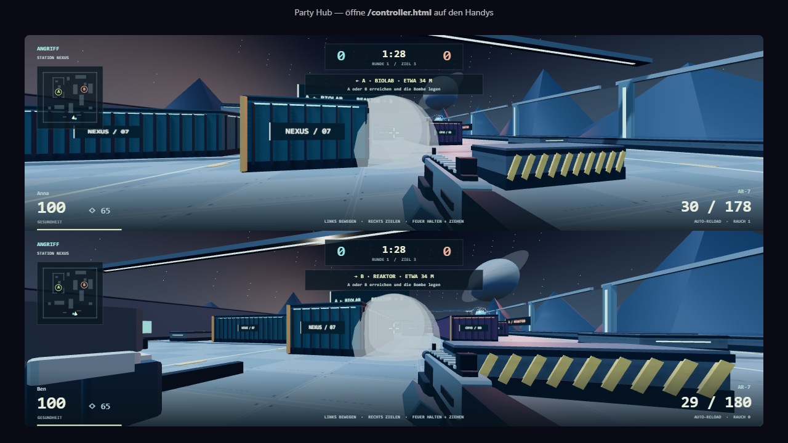
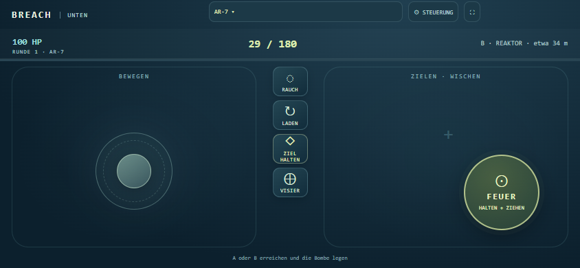

# BREACH — Station NEXUS



Feature proposals and the first-session feedback checklist:
[Plan nach eurer ersten Testrunde](BREACH-NACH-DER-TESTRUNDE.md).

## Revision after the first play session

- Short fire taps are latched across transport/simulation ticks. Each touch owns its
  pointer, so releasing a movement finger or a synthetic mouse event cannot stop fire.
  Blur, cancellation, leaving play and stale inputs release controls.
- Landscape controller with floating movement stick, large fire-and-drag zone,
  per-phone sensitivity, mirrored left-handed layout, and co-op-only aim assistance.
  Touch VISIER toggles aiming, leaving both thumbs free for movement and fire.
- Empty magazines automatically reload. Held fire resumes after reload; switching
  weapons preserves magazine/reserve counts and cancels the outgoing reload.
- Ten weapons, available from the phone arsenal, desktop menu, or number keys 1–0:
  AR-7, Vektor, P12, Bulldog, MR-9, Longbow, Atlas, Pulse-3, Kestrel, Titan .50.
  They include eight-pellet shotgun fire, three-round bursts, scoped zoom, large
  magazines, weapon-dependent movement, recoil, range falloff and reload timing.
- Entspannt is the default: fewer/slower co-op bots, 65 starting armor, 80 HP bots,
  and human regeneration at 7 HP/s after six seconds without damage. PvP humans
  retain 100 HP/40 armor and have no regeneration or bullet magnetism.
- Procedural panel textures, atmospheric sky/planet, reactor rings, route signs,
  colored station lighting, beveled weapon/operator models, impact sparks,
  weapon-specific sounds, shot-triggered flashes and reload progress.
- Shared objective guidance on screen and controller, with A/B radar labels, bearing
  and approximate straight-line distance, planting/defusing progress, movement hints,
  and mode-correct deathmatch/respawn messages.
- A phone stops held controls if screen updates cease for 1.8 seconds. Recovery
  requires a fresh press; browser-cancelled touches also cancel queued fire.
- Deathmatch respawns avoid occupied spawn points and give two seconds of protection,
  ending immediately when firing. All eight defender spawns are distinct. Bots reset
  interrupted planting progress and have their kills/deaths counted in the scoreboard.
- Laptop gestures unlock BREACH sound, and the Party Hub's mute button controls it.
- Phone reloads preserve the authenticated player slot for eight seconds and restore
  the BREACH controller and current actor state. The relay connects only after game
  modules and message handlers are ready. A longer disconnect still removes the player.
- Controller assets use versioned URLs and the local server sends `Cache-Control: no-store`.
  Both entry points use one touch stylesheet. Settings identify a mirrored layout and
  offer **STANDARDSTEUERUNG WIEDERHERSTELLEN**, without deleting player names or credentials.



## Modes and objective

- Party Hub: cooperative attackers versus bots; one phone per human, shared laptop split-screen.
- Private rooms: teams of human attackers/defenders; optional bots fill each side to three.
- Solo training: local simulation against relaxed bots; pauses when the menu opens.
- Tactical: 5-second equipment phase, 90-second round, first to 1/3/5 wins.
  Attackers hold E for 2.5 seconds on A or B, then protect the bomb for 25 seconds.
  Defenders hold E at the bomb for 5 seconds. Releasing or moving cancels the action.
  Eliminating defenders wins for attackers; eliminating attackers wins for defenders
  unless the bomb is already planted. Friendly fire is disabled.
- Team deathmatch: 150 seconds, 3-second respawns, team kills versus deaths determine victory.
- Free for All: all actors are opponents, including bots and former teammates. First
  to 15 kills or most kills after three minutes; tied kills draw, regardless of deaths.
  Individual rankings, winner attribution and Party Hub evening points replace teams.
  Eight distributed spawn points, 3-second respawns, existing spawn protection and free
  choice of all ten weapons. Optional bots fill to six actors; solo always has an opponent.
  Online without bots requires two people; departing FFA players leave rather than
  transferring their individual score to a replacement bot.
- Quickscope remains part of normal FFA: MR-9/Longbow enable the phone's **QUICK SCOPE**
  button in the unused objective-button slot. One tap scopes and queues one shot after
  100 ms; cancellation, reset or weapon changes remove it. Mouse right-click then
  left-click uses the same scoped shooting. Kills within 350 ms of aiming count as QS.
  Longbow scoped damage is 145 before armor, versus 95 unscoped. No aim magnetism in FFA.
- Weapon race: a team advances together through ten weapons, one stage per killing shot.
  Manual switching is locked. Each new stage refills ammunition; empty reserves are
  replenished on reload. Progress survives respawns. The tenth stage wins; after four
  minutes, the team with more stages wins (equal stages draw).
- Zone control: stand in A or B for three seconds to capture it automatically. A captured
  zone scores one point per second, including while unoccupied. Contesting or recapturing
  pauses its points; both teams present freeze capture progress. Leaving an unfinished
  capture resets it. First to 60 wins, or most points after three minutes. Three-second respawns.
- Survival: all friends share one cooperative team, including in online rooms. Five waves
  bring more guards (up to eight) and tougher enemies. Clear each wave within two minutes.
  Fallen teammates return next wave; everyone receives full health, armor and ammunition.
  A team wipe or a wave timeout ends the run. Round-win and bot-fill settings do not apply.
- All six modes are selectable in the Party Hub lobby, online host settings and solo menu.

## Architecture

`public/games/breach/world.js` owns map boxes, sites, spawns and weapon definitions.
`simulation.js` is shared by the browser and Node: authoritative collision, hitscan,
bot sight/pathfinding, ammunition, teams, bomb actions and state transitions.
`render.js` builds the original station, meshes, HUD and effects with the vendored
three.js. Static station panels use GPU instancing; smoke meshes are reused.
`input.js` supplies pointer-lock PC controls and independent multitouch controls.
`screen.js` and `controller.js` adapt those pieces to the existing Party Hub lifecycle.

`breach-server.js` serves private game rooms on `/breach-ws`, separately from the existing
Party Hub relay. It runs at 60 simulation ticks and up to 30 snapshots per second.
Room limits are 8 humans / 100 rooms. Input payloads are bounded, angles and movement
are validated, state-changing host commands are checked, and a client never supplies
its position, health or damage. Player names are rendered as text, not HTML.

`public/breach.html` is the independent entry point. Its client smooths positions and
uses immediate local camera rotation. It does not implement server rewind/lag compensation,
accounts, persistence, voice chat or public matchmaking. Higher-latency Internet
connections can therefore feel less responsive than a LAN.

## Verification

- `npm test`: existing shell/game suites, including BREACH registration and graceful
  WebGL-unavailable fallback, plus the new gameplay/network suites.
- `npm run test:breach`: map reachability; collision; wall-blocked hits/headshots;
  friendly-fire prevention; smoke visibility; reload accounting; stale/invalid input;
  planting, cancelling, defusing, detonation, timeout; respawns; team fill and loadouts.
  Also: released taps across cooldown, auto-reload for all ten weapons, firing across
  reload, inventory conservation, burst completion, pellet/sound count and difficulty
  separation. Input tests cover pointer ownership, compatibility mouse events,
  focus resets, immediate reactivation, saved settings and reset packet limits.
- Network test: two actual WebSocket clients; invitation join; host-only start;
  synchronized snapshots; independent movement; rejected client-supplied health/position;
  host migration; empty-room cleanup.
- Browser QA uses independent mobile browser contexts and touch events. This verifies
  browser behaviour; it does not claim testing on physical phones or across public networks.

Verified on 20 September 2026 in Chrome: two independent mobile contexts controlled
the upper/lower laptop views simultaneously, including movement, aiming while firing,
reload, smoke, planting from either controller, host rematch and abort cleanup.
Portrait and landscape layouts were inspected. A separate desktop/mobile pair joined
one online room and verified host settings/start, pointer lock, WASD, firing/reloading,
matching authoritative positions, host transfer and leaving the room. No JavaScript
runtime errors occurred in those flows. The complete `npm test` suite passed.

The revision additionally passed ten short fire taps from a full magazine (30 → 20),
two-finger movement/aim/fire with movement released first, automatic reload while
holding fire (new magazine 29 / reserve 150), all ten phone weapon selections,
saved 0.5× sensitivity/left-handed layout, reachable control centers at 740×360,
844×390 and 390×844, and all ten rendered weapon models. The host's abort button
initially overlapped the arsenal close button; the corrected layout passed the flow.
These checks used emulated mobile browsers with real WebSocket transport.

Final polish checks: withholding screen updates during held fire triggered the phone
watchdog and stopped firing; restoring updates recovered the controls without a shot.
Real touch planting showed progress and reset on release. Deathmatch showed respawn
and protection states. The laptop audio button resumed both audio contexts, muted
BREACH shot oscillators, and the game audio context closed on exit. Simulation tests
cover protection expiry/cancellation, occupied respawns, eight defender starts, bot
statistics, interrupted bot planting and all objective branches. Controller tests
also verify that signal recovery keeps gameplay controls disabled while settings remain open.

Mode expansion QA: deterministic tests cover all ten weapon stages, locked weapon input,
shared progress after respawn, zone capture/cancellation/contest/retake/scoring, all five
survival waves, revivals, increasing enemies, wipe/timeout losses and mode-specific hints.
Two real WebSocket clients verified all three modes and their snapshots. Chrome mobile
contexts verified each mode in the two-phone split-screen, solo and online flows, including
automatic team weapon upgrades, visible capture progress and cooperative online rosters.
Screenshots are in the ignored `output/playwright/mode-*` QA output. No page errors occurred.

FFA/quickscope QA: simulation tests cover free weapon selection, individual scoring and
ties, distributed starts/respawns, bot-versus-bot combat, the 15-kill finish, scoped damage,
queued taps, cooldowns and cancellation. Two WebSocket clients verify team-free room
membership, quickscope shots and the same individual winner on both clients.
Chrome checks passed with two emulated landscape phone controllers: a short quickscope
tap fires once, a cancelled touch does not fire, only the winner receives the evening
point, and a rematch resets the match scores. Online rooms reject a one-player start
without bots and start with two players without adding bots. A real mouse-button chord
under pointer lock also produced one quickscope kill (Longbow magazine 6 → 5).
Mouse input uses mousedown/up because pointerdown does not report a second held button;
regression tests cover both release orders. These browser flows produced no page errors.
Screenshots are in `output/playwright/ffa-*.png` (ignored QA output).

## Running on a different port

PowerShell:

```powershell
$env:PORT = '3995'
npm start
```

Use the LAN address printed by the server on phones, not `localhost`. The laptop and
phones must be able to reach each other on that network. If the OS asks whether Node
may accept connections, allow the private Wi-Fi network. The existing screen QR code
contains the correct controller address and port.
