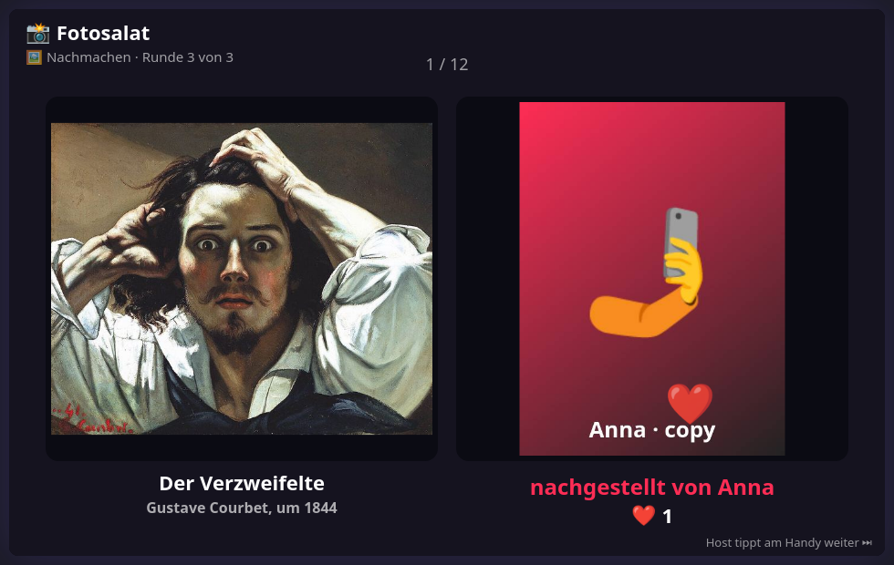

# 📸 Fotosalat — design notes

Mini-games with the phone camera under one entry in the menu. The host picks one in the settings:

| Game | What happens |
|---|---|
| 🖼️ **Nachmachen** | Everybody gets a picture and re-enacts it as a photo. After the last round the show: original and copy side by side |
| 🔍 **Zoom-Rätsel** | Everybody photographs something in the room. The TV shows a tiny cut-out and zooms out; who calls it first has it |
| 🏃 **Schnitzeljagd** | The TV asks for "something red"; everybody runs and photographs. Then all photos hang side by side |
| 🎁 **Bunte Tüte** | One round of each |

2+ phones, latecomers join the running round.

This file is the contract between the modules. If you change a shape or a rule here,
change it in the code and in the tests too.

## How a photo gets to the TV

The live camera (`getUserMedia`) only works over https, so not on the home Wi-Fi. A file
input with `capture` works over plain http: the button opens the phone's own camera app
and the finished picture comes back into the page. `core/snap.js` shrinks it (longest side
720 px, JPEG quality 0.72, about 30 to 130 KB) and the phone sends it to the TV as a data
URL in one message. Measured on an Android 10 phone: a 6.5 MB selfie became 33 KB in 0.4 s.

Photos live in the screen page's memory only. They are gone when the game ends or starts
again. Online (Render) they pass through the relay and Mitschauen viewers see them.

Some phones throw the page away while the camera app is open. The phone then loads again,
the shell puts it back into the game, and the screen's answer to `fsHello` tells it where
it was. Only the photo it was about to send is lost.

## Files

| File | Loaded by | Owns |
|---|---|---|
| `public/core/snap.js` | controller | the photo button: open the camera app, shrink, hand over a data URL → `window.Snap` |
| `public/games/fotosalat/meta.js` | screen + controller | key, label, settings |
| `public/games/fotosalat/rules.js` | screen (+ Node tests) | phases, dealing pictures, hearts, votes, the riddle's points → `window.FotoRules` |
| `public/games/fotosalat/art.js`, `art/*.jpg` | screen | 27 public-domain paintings with title, painter, year |
| `public/games/fotosalat/tasks.js` | screen | 60 hunt tasks |
| `public/games/fotosalat/screen.js` | screen | keeps the photos, phone protocol, stage, the 💾 album |
| `public/games/fotosalat/controller.js` | controller | one view that shows what `fsState` says |
| `public/dev-fotosalat.html` | — | TV harness with bots that send painted stand-ins; `?phone=1` adds the real phone UI |
| `public/dev-kamera.html` | — | test page: do the photo button and the microphone work on this phone? |
| `test-fotosalat.js` | Node | rule tests against `rules.js` |
| `test-fotosalat-flow.js` | Node/JSDOM | shell + phones end to end (the shrinking is replaced by a stand-in) |

`rules.js` knows no pictures. A photo is a handle (`ref`) there; `screen.js` maps handles
to `Image` objects. Time comes in from outside in milliseconds.

## Phases

A game is a list of phases, built from the settings:

| Setting | Phases |
|---|---|
| Nachmachen, paintings | `copy` × rounds, `show` |
| Nachmachen, own poses | (`pose`, `copy`) × rounds, `show` |
| Nachmachen, mixed (default) | odd rounds paintings, even rounds poses, then `show` |
| Zoom-Rätsel | (`zshoot`, `riddle`) × rounds |
| Schnitzeljagd | (`task`, `gallery`) × rounds |
| Bunte Tüte | `copy` (painting), `show`, `task`, `gallery`, `zshoot`, `riddle` |

Every game ends with `over`. A phase with nothing to show (nobody took a photo) is skipped.

- **Photo phases** (`pose`, `copy`, `task`, `zshoot`) end when the time is up, 3 s after
  everybody has delivered, or when the host taps "Nicht mehr warten". A second photo
  replaces the first.
- **Dealing:** nobody gets a painting somebody else had, as long as the 27 last (eight
  players, three rounds). A pose never goes back to who struck it; with one pose only its
  owner gets a painting instead.
- **show:** the original alone for 3.5 s, then the copy next to it. The host taps on; a
  pair nobody taps away leaves after 30 s.
- **gallery:** closes when the host taps or after 45 s.
- **riddle:** the photo starts 14× zoomed in around the point its photographer tapped and
  zooms out over 30 s. Guessing is done aloud in the room. The photographer taps the name
  of who called it first, or "nobody". Then the whole photo shows for 5 s.

## Scoring (setting, off by default)

Off: no hearts, no votes, no points, nobody wins. On:

- show: a ❤️ from each other player per pair, one point each
- gallery: one vote per player (not for yourself, changeable), counted when it closes
- riddle: 3, 2 or 1 points for calling it in the first, second or last third; 1 for the photographer
- the highest score is reported to the evening scoreboard

## Phone protocol

Phone → screen:

| Message | Meaning |
|---|---|
| `fsHello` | the phone entered the game or reloaded: answer with `fsState` (and `fsTpl`) |
| `fsPhoto {url}` | a photo: a JPEG data URL, at most 600 000 characters |
| `fsFocus {x, y}` | zoom riddle: where on my photo the zoom starts (0..1) |
| `fsHeart`, `fsVote {id}` | scoring |
| `fsGuess {id}` | riddle, photographer only: who called it (0: nobody) |
| `fsNext`, `fsAgain` | host only: stop waiting / next pair / reveal / next riddle; play again |

Screen → phone:

| Message | Meaning |
|---|---|
| `fsState {phase, key, round, rounds, wertung, host, …}` | everything this phone should show, sent to all phones whenever anything changes. `key` changes with each phase (the phone forgets its last photo then) |
| `fsTpl {url}` | somebody else's pose to copy; sent once per phase and again after a reload |

Per phase `fsState` also carries: `left`, `done`, `count`, `of` (photo phases); `tpl`
(`{art, title, by}` or `{pose, by}`); `task`; `focus`; `i`, `n`, `step`, `mine`,
`hearted` (show); `options`, `voted` (gallery); `owner`, `byName`, `options`, `solved`,
`solvedName` (riddle); `score`, `won` (over).

## 💾

The shell's save button builds one picture from everything photographed: pairs side by
side, hunt photos with their task, riddle photos. Offered from the first show on.

## Tunables

Top of `rules.js`: grace period, show and gallery times, zoom time and start factor.
`core/snap.js`: `MAX` and `QUALITY`.

## The paintings

All 27 are in the public domain: their painters died more than 70 years ago, and American
Gothic was published in 1930. The files are copies from Wikimedia Commons, scaled to 640 px.

| Painting | Painter | Source |
|---|---|---|
| Mona Lisa | Leonardo da Vinci, um 1503 | [Wikimedia Commons](https://commons.wikimedia.org/wiki/File:Mona_Lisa,_by_Leonardo_da_Vinci,_from_C2RMF_retouched.jpg) |
| Der Schrei | Edvard Munch, 1893 | [Wikimedia Commons](https://commons.wikimedia.org/wiki/File:Edvard_Munch,_1893,_The_Scream,_oil,_tempera_and_pastel_on_cardboard,_91_x_73_cm,_National_Gallery_of_Norway.jpg) |
| Das Mädchen mit dem Perlenohrring | Jan Vermeer, um 1665 | [Wikimedia Commons](https://commons.wikimedia.org/wiki/File:1665_Girl_with_a_Pearl_Earring.jpg) |
| Der Wanderer über dem Nebelmeer | Caspar David Friedrich, um 1818 | [Wikimedia Commons](https://commons.wikimedia.org/wiki/File:Caspar_David_Friedrich_-_Wanderer_above_the_sea_of_fog.jpg) |
| Der arme Poet | Carl Spitzweg, 1839 | [Wikimedia Commons](https://commons.wikimedia.org/wiki/File:Carl_Spitzweg_-_Der_arme_Poet_(Neue_Pinakothek).jpg) |
| American Gothic | Grant Wood, 1930 | [Wikimedia Commons](https://commons.wikimedia.org/wiki/File:Grant_Wood_-_American_Gothic_-_Google_Art_Project.jpg) |
| Selbstbildnis | Vincent van Gogh, 1889 | [Wikimedia Commons](https://commons.wikimedia.org/wiki/File:Vincent_van_Gogh_-_Self-Portrait_-_Google_Art_Project_(454045).jpg) |
| Bonaparte beim Überschreiten der Alpen | Jacques-Louis David, 1801 | [Wikimedia Commons](https://commons.wikimedia.org/wiki/File:David_-_Napoleon_crossing_the_Alps_-_Malmaison2.jpg) |
| Die Erschaffung Adams | Michelangelo, um 1511 | [Wikimedia Commons](https://commons.wikimedia.org/wiki/File:Michelangelo_-_Creation_of_Adam_(cropped).jpg) |
| Whistlers Mutter | James McNeill Whistler, 1871 | [Wikimedia Commons](https://commons.wikimedia.org/wiki/File:Whistlers_Mother_high_res.jpg) |
| Der Verzweifelte | Gustave Courbet, um 1844 | [Wikimedia Commons](https://commons.wikimedia.org/wiki/File:Gustave_Courbet_-_Le_D%C3%A9sesp%C3%A9r%C3%A9_(1843).jpg) |
| Die Dame mit dem Hermelin | Leonardo da Vinci, um 1490 | [Wikimedia Commons](https://commons.wikimedia.org/wiki/File:Lady_with_an_Ermine_-_Leonardo_da_Vinci_(adjusted_levels).jpg) |
| Dienstmagd mit Milchkrug | Jan Vermeer, um 1658 | [Wikimedia Commons](https://commons.wikimedia.org/wiki/File:Johannes_Vermeer_-_Het_melkmeisje_-_Google_Art_Project.jpg) |
| Die Arnolfini-Hochzeit | Jan van Eyck, 1434 | [Wikimedia Commons](https://commons.wikimedia.org/wiki/File:Van_Eyck_-_Arnolfini_Portrait.jpg) |
| Der Kuss | Gustav Klimt, 1908 | [Wikimedia Commons](https://commons.wikimedia.org/wiki/File:The_Kiss_-_Gustav_Klimt_-_Google_Cultural_Institute.jpg) |
| Selbstbildnis im Pelzrock | Albrecht Dürer, 1500 | [Wikimedia Commons](https://commons.wikimedia.org/wiki/File:Albrecht_D%C3%BCrer_-_1500_self-portrait_(High_resolution_and_detail).jpg) |
| Die Kartenspieler | Paul Cézanne, um 1895 | [Wikimedia Commons](https://commons.wikimedia.org/wiki/File:Les_Joueurs_de_cartes,_par_Paul_C%C3%A9zanne.jpg) |
| Der Tod des Marat | Jacques-Louis David, 1793 | [Wikimedia Commons](https://commons.wikimedia.org/wiki/File:Death_of_Marat_by_David.jpg) |
| Der lachende Kavalier | Frans Hals, 1624 | [Wikimedia Commons](https://commons.wikimedia.org/wiki/File:Cavalier_soldier_Hals-1624x.jpg) |
| Goethe in der Campagna | J. H. W. Tischbein, 1787 | [Wikimedia Commons](https://commons.wikimedia.org/wiki/File:Johann_Heinrich_Wilhelm_Tischbein_-_Goethe_in_the_Roman_Campagna_-_Google_Art_Project.jpg) |
| Flaming June | Frederic Leighton, 1895 | [Wikimedia Commons](https://commons.wikimedia.org/wiki/File:Flaming_June,_by_Frederic_Lord_Leighton_(1830-1896).jpg) |
| Der Bücherwurm | Carl Spitzweg, um 1850 | [Wikimedia Commons](https://commons.wikimedia.org/wiki/File:Carl_Spitzweg_-_%22The_Bookworm%22.jpg) |
| Washington überquert den Delaware | Emanuel Leutze, 1851 | [Wikimedia Commons](https://commons.wikimedia.org/wiki/File:Washington_Crossing_the_Delaware_by_Emanuel_Leutze,_MMA-NYC,_1851.jpg) |
| Der Knabe in Blau | Thomas Gainsborough, um 1770 | [Wikimedia Commons](https://commons.wikimedia.org/wiki/File:Thomas_Gainsborough_-_The_Blue_Boy_(c._1770).jpg) |
| Das Schokoladenmädchen | Jean-Étienne Liotard, um 1744 | [Wikimedia Commons](https://commons.wikimedia.org/wiki/File:Jean-Etienne_Liotard_-_Das_Schokoladenm%C3%A4dchen_(ca._1744).jpg) |
| Die Seifenblasen | Jean Siméon Chardin, um 1734 | [Wikimedia Commons](https://commons.wikimedia.org/wiki/File:Jean_Sim%C3%A9on_Chardin_-_Soap_Bubbles_-_Google_Art_Project.jpg) |
| Bar in den Folies-Bergère | Édouard Manet, 1882 | [Wikimedia Commons](https://commons.wikimedia.org/wiki/File:Edouard_Manet,_A_Bar_at_the_Folies-Berg%C3%A8re.jpg) |

## Not in version 1

Photo telephone (word → photo → guess → photo, the flow of Drawing Evolution), describing a
word with a photo while letters appear, mixing faces. iPhones are expected to work the same
way (the file input with `capture` is old and common), but only an Android phone has been
tested so far.
