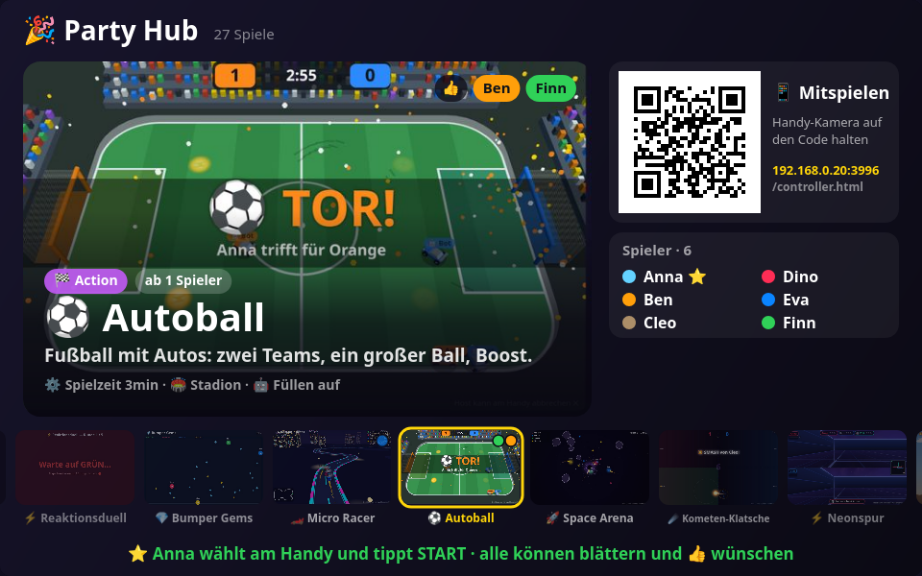

# 🎉 The lobby — design notes

The start menu is a shop window. The TV shows one game big, with a picture, one sentence and
the host's settings; below it a filmstrip of its neighbours; on the right the join code, the
players, the wishes and the evening's score. Every phone has the whole catalogue to browse.



## Who does what

- **Everybody** browses the catalogue on their own phone: cards with picture, name, one
  sentence, how many players it needs. Chips at the top filter by category or show what has
  been wished for.
- **Everybody** can wish for up to three games (👍). A wish shows on the TV in the player's
  colour: as a dot on the game's tile, as a name on the big picture, and in the "Gewünscht"
  list. A second tap takes it back; a fourth wish pushes the oldest out. Starting a game
  fulfils its wishes; who leaves takes theirs along.
- **The host** chooses: a tap on a card puts that game on the TV, and the card opens with
  the game's settings. "🎲 Zufall" rolls a game that can start with the players present,
  "👍 Meistgewünscht" takes the one with the most thumbs. START sits in a bar at the bottom;
  renaming and removing players and "Feierabend" are behind 👥.
- **Nobody there yet:** the TV flips through the games by itself, one every 7 s.

For the others a tap anywhere on a card is a wish, since they cannot choose.

## Files

| File | Owns |
|---|---|
| `public/core/lobby.js` | the TV side: `renderLobby()`, `lobbyToast()`, `lobbyOrder()` |
| `public/screen.html` | shell state (`shell.selected`, `shell.wishes`), the `shellWish` message, what `sendLobby()` tells the phones |
| `public/controller.html` | the phone side: catalogue, chips, host bar (`buildPicker`, `refreshPicker`) |
| `public/core/game-registry.js` | `about` and `cat` per game, the category list `GAME_CATS` |
| `public/covers/<key>.jpg` | one picture per game, 640×400 |
| `public/dev-lobby.html` | the real lobby on one page: TV and phones in frames, joined by themselves |
| `public/dev-any.html`, `public/dev-cover.html` | tools for making cover pictures (below) |
| `test-lobby.js` | catalogue, choosing, wishes; and that every game has sentence, category and cover |

## What a game brings

In its `meta.js`, next to key, label and min:

```js
registerGame({ key: 'meingame', label: '🎮 Mein Spiel', min: 2,
  about: 'Was man hier tut, in einem Satz.',      // under 90 characters, German
  cat: 'action',                                   // action | duell | koop | kreativ | raten
  settings: { … } });
```

and a picture `public/covers/meingame.jpg` (640×400, about 30 KB). Without a picture the
lobby shows the game's emoji on a colour of its own, so nothing breaks; `test-lobby.js`
insists on all three.

The lobby shows a choice setting as a row of its options, without the setting's label, on
the phone and in the settings line on the TV. So every option has to say what it is about
("Ohne Wertung", not "Aus").

## Messages

- phone → screen: `shellWish { game }` toggles a wish (any named player, lobby only).
- screen → phone: the `lobby` command gained `color`, `hostName`, `wish` (`{ key: count }`)
  and `mine` (this player's wishes). `games` carries `about` and `cat`.

Everything else (select, config, start, kick, rename, night) is unchanged.

## Making a cover picture

A cover is a screenshot of the game's TV side at 960×600, scaled to 640×400.

1. Get the game running without phones. A game with its own harness: `dev-<key>.html?sim=<ms>`.
   Any other game: `dev-any.html?game=<key>&sim=<ms>`, which reads the game's scripts from
   `screen.html`, stubs the shell and lets simple bots press buttons (add a driver there if
   your game needs input to look alive).
2. Wrap it in `dev-cover.html?u=<that address, url-encoded>`: it copies the game's canvas
   into one that fills the window exactly, whatever the dev page's own layout.
3. Screenshot at 960×600 and scale:

```bash
PORT=3995 node server.js &
firefox --headless --no-remote --profile /tmp/ffp --window-size=960,600 --screenshot shot.png \
  "http://localhost:3995/dev-cover.html?u=dev-any.html%3Fgame%3Dslither%26sim%3D25000"
convert shot.png -resize 640x400 -quality 80 public/covers/slither.jpg
```

A headless screenshot is taken when the page has loaded, which is before a long `sim` has
finished and before pictures inside the game are decoded. `dev-cover.html?hold=<url>` keeps
the page loading as long as that address takes to answer; a three-line local server that
answers after a few seconds does the job.

Where the covers in the repo come from: one straight from its dev page (Wer spricht da?), 20 through `dev-cover.html` (nine of them with
`dev-any.html`: Light Cycles, Slither, Bumper Gems, Reaktionsduell, Geo-Pin, Spion, Stadt
Land Fluss, Drawing Evolution, Fake Artist; Light Cycles without `sim`, because its
countdown runs on real timers), seven from the pictures in `docs/` (Micro Racer, Autoball,
Skyfarers, Furt & Fehde, BREACH, Fotosalat, Rückwärtsgang).
