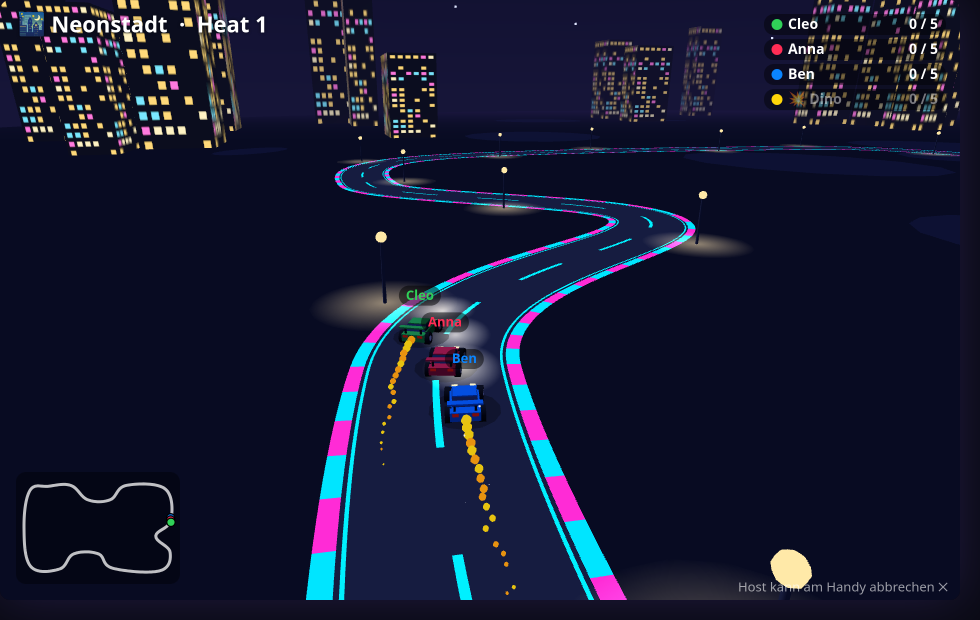

# 🏎️ Micro Racer — design notes

A Micro-Machines-style elimination race in real 3D: 2+ phones, one shared camera behind
the leader. **Whoever leaves the picture is out.** The last car left wins the heat; heats
give points until one player reaches the target alone.

This file is the contract between the modules. If you change a shape or a rule here,
change it in the code and in the tests too.

## Files

| File | Loaded by | Owns |
|---|---|---|
| `public/games/racer/meta.js` | screen + controller | key, label, settings |
| `public/games/racer/tracks.js` | screen (+ Node tests) | tracks (control points) and biomes → `window.RacerTracks` |
| `public/games/racer/sim.js` | screen (+ Node tests) | all rules, the camera, items, heats → `window.RacerSim` |
| `public/games/racer/render.js` | screen | three.js diorama, cars, particles → `window.RacerView` |
| `public/games/racer/screen.js` | screen | glue: lifecycle, phone protocol, HUD, sound, Mitschauen copy |
| `public/games/racer/controller.js` | controller | phone pad |
| `public/dev-racer.html` | — | TV harness with four bots (`?track=…&sim=<ms>&items=off&target=N`) |
| `test-racer.js` | Node | rule tests against `sim.js` + `tracks.js` |
| `test-racer-flow.js` | Node/JSDOM | shell + phones end to end with a stub view |

`sim.js` has no three.js and no DOM. Everything random comes from one seed, so a match
replays exactly in the tests.

## The rule that matters: out of the picture → out

The camera is part of the simulation, because it decides who is out.

- The camera sits behind the leader (the car with the most track progress) and looks
  along the road. It opens up as the field stretches: `CAM_NEAR` → `CAM_FAR`.
- Each frame every car is projected into the picture (`sim.project`). A car counts as
  **visible** when it is inside the frame, at most `MAX_VIEW` metres from the camera and
  at most `MAX_BEHIND` metres behind the leader along the track.
- A car that is not visible collects `offMs`. At `OFF_MS` (0.8 s) it is eliminated. Coming
  back into the picture resets the clock. Nobody is out in the first `START_SAFE_MS`.
- In practice a car stays in the picture up to about 25 m behind the leader.
  `test-racer.js` pins this on every track: 20 m behind is in, 36 m behind is out, and
  no bot ever drives blind for longer than the grace.

The TV shows a marker at the edge with a ring that runs out; the phone flashes red and
vibrates.

## Driving

The throttle is always open. The phone sends steering `s` (-1..1) and the brake `b`.

- **Brake = both arrows at once.** Speed drops to 30 %. Turning rate falls more slowly
  than speed, so a slow car turns a much tighter circle: brake before a hairpin.
- Nitro: +50 % for 2.2 s, then 6.5 s of cooldown.
- Slipstream: right behind another car gives up to +9 % top speed.
- Catch-up: chasers get up to +6 %, growing with the gap to the leader.
- Tempo: after 25 s a heat gets 0.7 % faster every second (up to +60 %), so it ends.
- Off the road: 42 % speed. Snow has less grip. Lava (Vulkan) eliminates at once.
- Cars push each other. A car that brakes in front of you gets shoved along.

## Track furniture and items

Placed once per match from the seed, on the straightest free spots: 2 ramps, 3 boost
pads, 2 oil puddles and (with items on) 3 rows of item boxes. A box gives one item and
comes back after 5 s. What it gives depends on the place in the field:

| Item | Effect | Who gets it |
|---|---|---|
| 🚀 Rakete | flies to the next car in front, spins it out | everyone but the leader |
| 🛢️ Öl | drops a slick behind the car | everyone |
| 🛡️ Schild | 4 s safe from rockets, oil and lightning | everyone |
| ⚡ Blitz | all other cars shrink and slow down for 2 s | not the leader, mostly the last |
| 🧲 Magnet | +35 % speed for 2.2 s, pulled towards the car in front | everyone but the leader |

## Heats and points

A heat ends when one car is left. Points by how long you lasted: first one out 0, the
survivor n−1. The next grid puts the fewest points in front. The match ends when one
player alone has reached the target; a tie at the top means another heat.

## Phone protocol

| Direction | Message | Meaning |
|---|---|---|
| phone → TV | `raceSteer { s, b }` | steering -1..1, brake |
| | `raceNitro`, `raceItem` | fire nitro / use the held item |
| | `raceAgain` | host only, on the final screen |
| TV → phone | `raceState { phase, heat, items }` | on every phase change and after a reload |
| | `raceYou { rank, of, nitro, item, danger, out, why, msg, buzz }` | only the fields that changed |
| | `raceScore { won, points, target }` | after each heat |
| | `raceFinal { winner, name, host }` | tournament over |

The sim reports what happened as events from `sim.step(dt)` (`go`, `out`, `pickup`,
`spin`, `heatEnd`, …). `screen.js` turns them into phone messages, sounds and effects.

## Picture

`render.js` builds one diorama per match and frees it afterwards; the WebGL context and
the canvases are kept for the whole evening. The 3D canvas renders at up to 2× on big
screens and falls back to 1× for good when frames get slow. The HUD is a 2D canvas on
top. Both are copied into the shell canvas a few times a second, so Mitschauen works.

A headless screenshot cannot see WebGL. `dev-racer.html?sim=…` therefore shows that
copy instead of the live canvases.

## Tunables

All numbers sit at the top of `sim.js` and are guesses until real people have played:
grace period, zoom, item weights, tempo ramp, brake strength.
