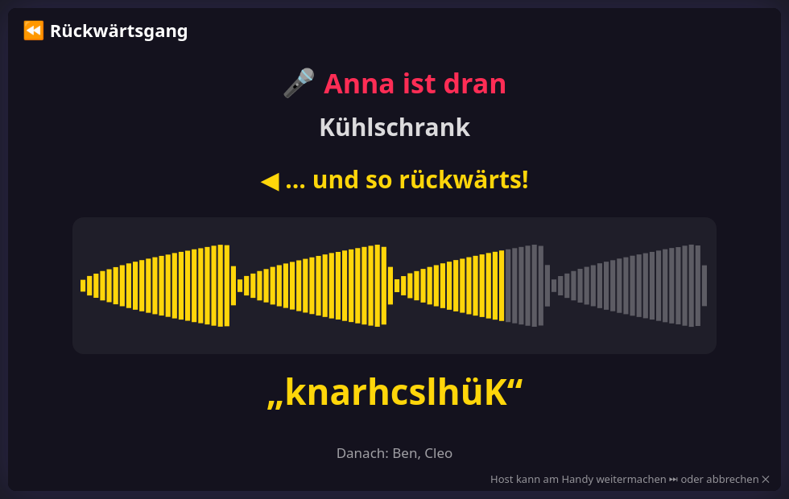

# ⏪ Rückwärtsgang — design notes

Say a word into the phone. The TV plays it backwards. Imitate that gibberish as well as you
can. The TV turns your imitation round: if you were good, the word comes out again. Mostly
something comes out that makes the whole room laugh. 1+ phones.

Two modes:

- **Alle dasselbe Wort** (default): one player speaks the word, everybody imitates its
  reverse, and in the show every attempt is played while the others clap on their phones.
- **Jeder sein Wort:** one player at a time has a word of their own, everything on stage.

This file is the contract between the modules. If you change a shape or a rule here,
change it in the code and in the tests too.

## How a voice gets to the TV

Browsers hand out the live microphone (`getUserMedia`) only over https or localhost, and the
home Wi-Fi runs on plain http. So `core/mic.js` knows two ways:

| Way | When | How it feels |
|---|---|---|
| live | the page is a secure context (Render, localhost) | tap to start, tap to stop, at most 4.5 s |
| file | everywhere else | the button opens the phone's recorder app (`<input type="file" accept="audio/*" capture>`), or the camera for a short video whose sound is used (`accept="video/*"`) |

iPhones offer no recorder app for sound, so there the video is the first button and the
recorder app the fallback link; on other phones it is the other way round. Measured on an
Android 10 phone over http: the recorder app returns an m4a file the browser can decode;
the video way works too.

Whatever the way, the phone ends up with raw samples. It cuts the silence at both ends,
levels the volume, shrinks to 16 kHz mono and sends 16-bit samples as base64 in one message
(`core/voiceclip.js`, about 43 KB per second). So the TV never has to understand a phone's audio
format: it unpacks, reverses and plays. Cutting the silence matters: played backwards,
silence at the end would become a pause at the start.

Recordings live in the screen page's memory only and are gone when the game ends.

## Files

| File | Loaded by | Owns |
|---|---|---|
| `public/core/mic.js` | controller | recording: live microphone or the phone's recorder app → `window.Mic` |
| `public/games/rueckwaerts/meta.js` | screen + controller | key, label, settings |
| `public/core/voiceclip.js` | screen + controller (+ Node tests) | the sums on a recording: trim, level, resample, reverse, pack, unpack → `window.VoiceClip` |
| `public/games/rueckwaerts/words.js` | screen | three word lists |
| `public/games/rueckwaerts/rules.js` | screen (+ Node tests) | turns, what the TV plays when, recap, vote → `window.RwRules` |
| `public/games/rueckwaerts/screen.js` | screen | keeps the recordings, plays them, phone protocol, stage |
| `public/games/rueckwaerts/controller.js` | controller | one view that shows what `rwState` says, and the record buttons |
| `public/dev-rueckwaerts.html` | — | TV harness with bots that "speak" melodies; `?phone=1` adds the real phone UI (on localhost with the live microphone) |
| `test-rueckwaerts.js` | Node | tests for `core/voiceclip.js` and `rules.js` |
| `test-rueckwaerts-flow.js`, `test-rueckwaerts-alle-flow.js` | Node/JSDOM | shell + phones end to end, one file per mode (reading the recorded file is replaced by a stand-in) |

`rules.js` knows no sound. A recording is a handle (`ref`) with its length there.

## A round in "alle dasselbe Wort"

| Phase | TV | Phones |
|---|---|---|
| `say` | "Anna spricht vor: ANANAS" | the speaker records the word; the speaker changes every round |
| `listen` | plays it forwards, then backwards, shows the word spelled backwards | the speaker can replay, say it again, or give the go (not while the TV plays). Without a go, recording starts 15 s after the TV finished |
| `rec` | "Alle sprechen nach!", a clock, a tile per player | everybody records the imitation |
| `show` | one imitation after the other, played backwards, with an applause meter | everybody but its owner hammers 👏; every tap claps on the TV |
| `result` | the original once more, bars with everybody's applause | "👑 most applause" or "👏 n for you" |

Recording (`rec`) comes in two flavours, a setting:

- **zugleich:** all at once, 45 s; a second recording replaces the first; 2 s after the last
  player has delivered it goes on. Phones held close pick up mostly their owner, so this is
  the default. Untested with real voices in one room.
- **reihum:** one after the other, 30 s each, in a fixed order; a recording passes the turn
  on, who takes too long is passed over. Nothing is revealed before the show.

Applause: a tap counts while that imitation is on, up to 20 taps per player, never for
yourself. Clapping does not change what the phones show, so it is not broadcast to them;
the TV draws and sounds it. With scoring on, applause is the score and the most applause
over all words wins the evening point. With scoring off there is applause but no winner.

The host can move every phase on. A speaker who leaves hands the round to the next one.

## A turn in "jeder sein Wort"

| Phase | TV | The player's phone |
|---|---|---|
| `say` | "Anna ist dran: ANANAS" | record the word (recording A) |
| `listen` | plays A forwards, then backwards, and shows the word spelled backwards | wait while the TV plays; then record the imitation (B), hear it again, or say the word again |
| `reveal` | drum roll, B backwards, then A to compare | hear it again, try again (back to `listen`, B is dropped), or done |

After the last turn: `recap` (every original and its result once more, by itself, the host
can hurry), then `vote` if scoring is on and at least two players have a result, then `over`.

What the TV plays is a list of cues the rules derive from the phase (`game.cues()`): which
recording, forwards or backwards, how many ms after the phase began. `screen.js` schedules
them whenever the phase or its start time changes. "Hear it again" just moves the start
time. While cues are running the phone's buttons wait (`busyMs`), because the microphone
would hear the TV.

The host can skip a turn that hangs (`say`, `listen`: no result) or move on from a `reveal`
(the result counts). A player who leaves during their turn is passed over; results of
players who left stay in the recap.

## Settings

- Mode, and in "alle" how to record (at once or one after the other) and how many words (1 to 8)
- Words: from the game (easy, medium, or whole sentences) or the player's own
- Rounds, in "jeder sein Wort": 1 to 3, each player has one turn per round
- Scoring, off by default. On in "jeder sein Wort": after the recap everybody votes for the result that came
  closest (not their own); most votes win the evening point

## Phone protocol

Phone → screen:

| Message | Meaning |
|---|---|
| `rwHello` | the phone entered the game or reloaded: answer with `rwState` |
| `rwClip {pcm}` | a recording of the player on turn: base64 of 16-bit samples at 16 kHz, at most 300 000 characters |
| `rwPlay`, `rwAgain`, `rwDone` | the player on turn: hear it again / say the word again or try again / done |
| `rwVote {i}` | vote for result `i` |
| `rwClap` | mode "alle": one clap for the imitation that is playing |
| `rwNext`, `rwRestart` | host only: skip or move on; play again |

Screen → phone: `rwState {phase, modus, host, wertung, frei, canRec, …}`, sent to all phones
whenever anything changes. `canRec` says whether this phone may record right now. In the mode
"alle" it also carries `round`, `rounds`; in `rec`: `left`, `done`, `count`, `of`, `reihum`,
`turn`, `turnName`, `wait`; in `show`: `i`, `n`, `by`, `byName`, `mine`, `canClap`; in `result`:
`claps`, `best`. During a turn it carries `cur`, `curName`, `mine`, `word`, `tries`, `busy`,
`busyMs`, `left`, `nextNames`, `soon`; in the recap `i`, `n`, `curName`, `word`; in the vote
`options` and `voted`; at the end `score` and `won`.

## Tunables

Top of `rules.js`: the pauses around what the TV plays. Top of `core/voiceclip.js`: sample rate,
longest recording, the silence threshold. `core/mic.js`: `MAX_MS`. `screen.js`: `GAIN`.

## Not in version 1

A guessing mode (the word is secret, the others hear only the result and choose from four),
a chain (one player's result is the next player's word), singing a line instead of a word.
No iPhone has been tested yet.
