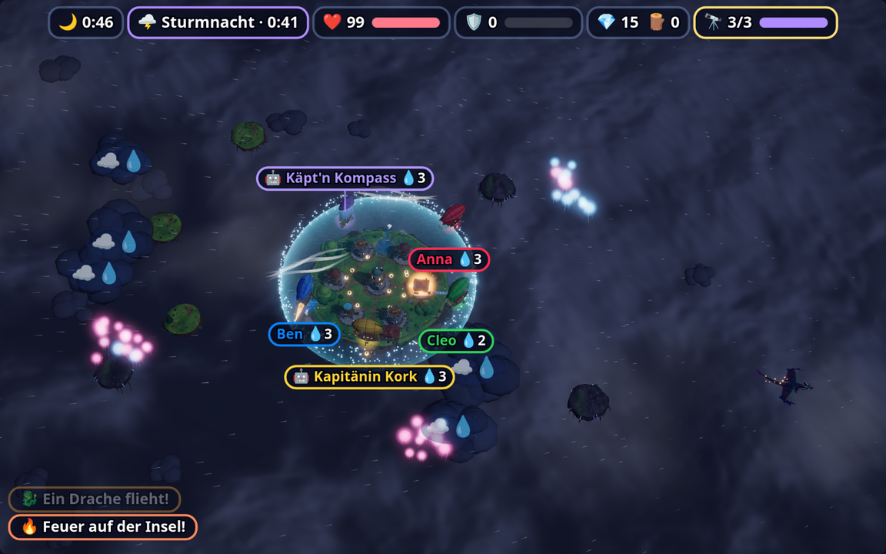

# 🎈 Skyfarers — design notes (Phase 1)



> Planned 2026-10-31; built in waves by builder agents (see "Implementation notes").

A cooperative airship game for Party Hub. Every phone is the cockpit of a small airship;
the **TV** shows one shared, living 3D sky archipelago: a home island with a crystal heart,
drifting islets with crystal veins and trees, rain clouds, wind gusts, jellyfish swarms and
birds, a full day from sunrise to the storm night. Captains gather resources, dock at home,
build, and defend the island together when storms and sky dragons hit. If the island
survives until dawn, everyone wins; how well is counted in stars.

> Player-facing text is German with emoji. Docs and code comments are English.

This file is the **contract** between the modules. If you change a shape or a rule, change
it here too (main session only — agents report interpretations, the main session folds them
in, see "Implementation notes").

## Decisions (from the planning session)

| Topic | Decision |
|---|---|
| Rendering | three.js 3D (vendored r185), stylized low-poly, one shared camera |
| Screen device | sometimes a PC, sometimes the Samsung M7's built-in browser → setting **Grafik: Auto / Voll / Sparsam** |
| Mode | **co-op against nature**: one shared home island, everyone wins or loses together |
| Flow | **fluid**: gather and build at any time (docking opens the build menu), announced **event waves** as climaxes |
| Phase 1 look | core + **day/night & weather** + **fauna** + **construction animations & inhabitants** |
| Ships | all identical; a **context action** button decides what the ship does |
| Name | **🎈 Skyfarers**, key `skyfarers`, message prefix `sk` |
| Not in Phase 1 | ship customization, persistence across evenings, team mode, music score |

## Phase 1 scope

| Feature | Phase |
|---|---|
| Fly (analog stick + boost), harvest crystal & wood, collect rain water, ride gusts | 1 |
| Dock at home: auto-unload, build menu on the phone, 5 building kinds, construction time | 1 |
| Events: ⛈️ Sturm, 🐉 Drachen, 🌩️ Sturmnacht (final) with warnings | 1 |
| Fire, lightning, shield, cannons, harpoons, repair, island heart, sinking island | 1 |
| Day/night over the match, rain, lightning, god rays, fog banks, night lights | 1 |
| Jellyfish swarms and bird flocks reacting to ships (cosmetic) | 1 |
| Scaffolding, cranes, sparks, smoking chimneys, waterfalls, walking inhabitants | 1 |
| Co-op bot captains, Auto quality, Mitschauen, dev harnesses, tests | 1 |
| Ship customization (hull colour, crest, sails) chosen on the phone | 2 |
| More events (Meteorschauer, Nebelbank, Luftpiraten, Himmelswal), more buildings, generative music | 2 |
| Island/captain persistence across evenings, team mode (two islands) | 3 |

## The match (one round = one day)

Length is the host setting `dauer`. The day clock `dayT` runs 0 → 1 over the match and
drives the light: 0 sunrise · 0.35 noon · 0.65 sunset · 0.75–0.98 night · 1.0 dawn.

| `dauer` | length | events (start s – end s) |
|---|---|---|
| `kurz` | 240 s | ⛈️ Sturm 70–110 · 🌩️ Sturmnacht 185–235 |
| `normal` (default) | 360 s | ⛈️ Sturm 90–135 · 🐉 Drachen 210–250 · 🌩️ Sturmnacht 300–355 |
| `lang` | 480 s | ⛈️ Sturm 90–135 · 🐉 Drachen 200–240 · ⛈️ Sturm (stronger) 300–345 · 🌩️ Sturmnacht 410–470 |

- Every event is **announced 15 s ahead** (`WARN_S`): TV banner + phone alert + vibration.
- Phases of the glue: `intro` (4 s: camera flies in over the archipelago, title card) →
  `live` → `end` (result screen). There is no separate build phase.
- **Loss:** the island heart (`herz`, 0–100) reaches 0 → the island sinks (big animation),
  `end` with `survived: false`.
- **Win:** the clock reaches the end with `herz > 0`. Stars:
  - ⭐ survived until dawn
  - ⭐⭐ survived **and** the 🔭 Sternwarte is complete (all 3 stages)
  - ⭐⭐⭐ as ⭐⭐ **and** `herz ≥ 60` at the end
- `reportWinners(all human captains present at the end)` when survived (co-op win). The
  most valuable captain (MVP score, see "Scoring") is shown as "⭐ Kapitän der Runde" —
  honour only, not reported.
- End screen: stars, MVP, per-captain stats; host gets **🔁 Nochmal** (`skAgain`).

## World and coordinates

- The sim is **2D top-down**. World units, origin at the home island's centre:
  `x ∈ [−80, 80]`, `y ∈ [−50, 50]` (16:10 like the screen). Ships get pushed back softly
  beyond `|x| > 76` / `|y| > 46`.
- three.js world: **X = x, Z = y, Y = up**, 1 world unit = 1 three.js unit. Ships cruise at
  `Y ≈ 6` (plus bobbing in the renderer); the home island's top surface is at `Y = 0`.
  Ship heading `h` (radians, 0 = +x, counter-clockwise towards +y) → yaw = `-h` about +Y
  when the model's nose points along +X.
- Home island: radius `HOME_R = 16`, dock ring at radius `DOCK_R = 21` (a ship within
  `DOCK_R` and slower than `DOCK_SPEED` is **docked**). 7 building slots: `0` = centre
  (Sternwarte only), `1..6` on a ring at radius 10, angles `k · 60°`.
- Resource islets (`world.js` generates them from the seed): 4 **crystal rocks** and 3
  **wood islets**, placed on a ring between radius 30 and 46 (elliptical to fill 16:10), at
  least 14 apart. Islets **drift**: each moves on a small closed orbit (radius 2–4, period
  60–120 s) around its anchor — position is a pure function of sim time.
- **Rain clouds** (2–3, more in storms) drift with the wind across the map and wrap around.
- **Gusts** (`gusts`) spawn every 6 s (storm: every 3 s): a straight streak 20 long, lives
  5 s; flying along it refills boost.
- Islands, islets and clouds are circles for collision; ships are circles of radius 1.2.

## Ships

- One ship per captain (human or bot), colour = player colour, spawned at the dock.
- Movement: input stick `(sx, sy)` ∈ unit disc. Target velocity = stick · `SPEED` (12 u/s),
  boosting × `BOOST_MUL` (1.8). Acceleration `ACCEL` (20 u/s²), drag towards the target.
  Heading turns towards the velocity direction at ≤ `TURN` (3.5 rad/s); the renderer banks
  into turns. Storm wind adds a force (`wind · WIND_PUSH`).
- `boost` 0..1: holding boost drains `BOOST_USE` (0.35/s), refills `BOOST_REGEN` (0.06/s),
  riding a gust refills `GUST_GAIN` (0.5/s).
- **Hold** (`cargo`): `{ kristall, holz }`, total ≤ `cap` (6; +2 with a working 🔧 Werkstatt).
- **Water tank** `water` 0..`WATER_CAP` (3): fills 1 per second inside a rain cloud, refilled
  to full while docked if a working 💧 Zisterne exists.
- **Stunned** (lightning, dragon tail): 2.5 s at 40 % speed, smoke trail, **drops half the
  cargo** (rounded up) as floating crates (`drops`) that anyone can pick up by flying over
  them; crates fade after 30 s. Nobody dies, nobody sits out.
- Ship–ship contact: soft push-apart, no damage. Ship–island/islet: pushed out.

### The context action (`act`)

The ship has one action button; the sim decides what it does, in this priority order:

| `act` | Condition | Effect (while held unless noted) |
|---|---|---|
| `shield` | docked, storm/night event running, shield built (≥ 1 working 🌀 Windrad) | island shield on while held and `energy > 0` |
| `extinguish` | water > 0 and a burning slot within 12 | spray: −1 water per 0.5 s, each unit −0.35 fire on that slot |
| `shoot` | a dragon within 18 | harpoon shot every 0.8 s, 1 damage on hit |
| `harvest` | a crystal node or a tree within 5, hold not full | +1 every 2.6 s from the nearest node |
| `repair` | docked, a damaged/ruined building, ≥ 1 holz in stock | +20 HP/s on the most damaged slot, costs 1 holz per 50 HP |
| `horn` | otherwise | tap: honk (birds scatter, inhabitants wave). Cosmetic |

The phone shows the button's current label/icon (`skYou.act`).

## Resources

| Key | Icon | Where | Notes |
|---|---|---|---|
| `kristall` | 💎 | crystal veins on the 4 rocks | each rock has 8 units, regrows 1 per 40 s |
| `holz` | 🪵 | trees on the 3 wood islets | each islet 10 units, regrows 1 per 34 s; chopped trees shrink to stumps and regrow |
| `water` | 💧 | rain clouds, Zisterne | ship-local, never stocked |
| `boost` | 🌬️ | gusts, slow regen | ship-local |

**Docking auto-unloads** the hold into the shared `stock` (one unit per 0.15 s, so the TV
can animate crates flying to the storehouse).

## Buildings

Ordered from the phone while docked (`skBuild`). Cost is paid from `stock` at order time;
the TV picks the slot (first free ring slot clockwise from the docked ship's side; centre is
reserved for the Sternwarte). Kinds may repeat; 6 ring slots in total.

| Kind | Name | Cost | Build | HP | Function while working (not burning/ruined) |
|---|---|---|---|---|---|
| `windrad` | 🌀 Windrad | 2 🪵 1 💎 | 6 s | 60 | `energy` +2/s (×2 during storms), cap 100; enables `shield` |
| `kanone` | 💣 Kanonenturm | 3 🪵 2 💎 | 10 s | 80 | shoots the nearest dragon within 28 every 1.5 s (1 damage) |
| `zisterne` | 💧 Zisterne | 3 🪵 | 8 s | 70 | fire −0.05/s on its own and both neighbour slots; refills docked ships' water |
| `werkstatt` | 🔧 Werkstatt | 2 🪵 2 💎 | 8 s | 70 | ship `cap` +2; every working building regains 2 HP/s |
| `sternwarte` | 🔭 Sternwarte | 9 🪵 9 💎 per stage | 12 s per stage | 120 | goal: 3 stages; stage `n+1` can be ordered once stage `n` is done |

- A slot: `{ kind, stage, build (0..1 progress, 1 = done), hp, fire (0..1), ruined }`.
- **Shield:** while on, drains `energy` 8/s; lightning on the island is absorbed and dragon
  fire bounces off. Visual: a translucent dome over the island.
- **Ruined** (hp 0): no function, fire goes out, can be rebuilt by ordering the same kind on
  that slot for 50 % of the cost (rounded up); a ruined Sternwarte keeps its stage count but
  stops counting as complete until rebuilt.

## Hazards

- **Fire** (per slot, 0..1): burns building HP at `25 · fire` HP/s and the heart at
  `0.4 · fire`/s; grows +0.04/s; a slot above 0.6 for 6 s ignites a neighbour slot at 0.2.
  Rain during storms: −0.02/s everywhere. Extinguish with ship water, Zisterne.
- **Lightning** (storm/night): every `LIGHTNING_EVERY` s (normal 2.5) a strike is
  **telegraphed 0.8 s ahead** (`strikeWarn` event) at a target: 50 % a random slot on the
  island (→ fire 0.5 unless shielded; on the empty centre slot → heart −4), 35 % the
  position of a random ship (→ stunned if still within 3), 15 % open sky (visual only).
- **Storm wind:** a wind vector of strength 6–10 that rotates slowly; pushes ships.
- **Dragons** (`dragons`, Drachen event 2/3/4 by difficulty, Sturmnacht 1/2/3): enter from a
  map edge, fly to the island, circle at radius 18–24. Every 4 s one breathes fire on a
  random working slot (fire +0.6; no buildings → heart −6), unless shielded. A dragon that
  passes within 4 of a ship tail-swipes it (stunned). HP 6; at 0 it **flees** (flies off the
  map, event `dragonFlee`) — no gore, no deaths. Dragons left at event end also flee.
- **Heart** `herz` 0..100: starts at 100, regenerates +0.5/s outside events while no slot
  burns. At 0 → loss.

## Difficulty (`schwierigkeit`)

| | `leicht` | `normal` | `heftig` |
|---|---|---|---|
| lightning every | 3.5 s | 2.5 s | 1.6 s |
| dragons (Drachen / Nacht) | 2 / 1 | 3 / 2 | 4 / 3 |
| fire growth | 0.03/s | 0.04/s | 0.06/s |
| start stock | 4 🪵 2 💎 | 2 🪵 0 💎 | 0 |

All tunables are named constants at the top of `sim.js` (`CONST`). Numbers are honest
guesses until real humans play.

## Scoring (per captain, for the MVP and the end stats)

`delivered` (units unloaded) ×1, `built` (buildings/stages ordered) ×3, `fires` (fire
removed, in 0.1 steps) ×1, `dragonHits` ×2, `repairs` (per 50 HP) ×2. Bots are listed but
cannot be MVP while a human scored > 0.

## Modules and files

| File | Loaded by | Owns |
|---|---|---|
| `public/games/skyfarers/meta.js` | screen + controller | key, label, `min: 1`, settings |
| `public/games/skyfarers/world.js` | screen (+ Node) | catalogs (buildings, resources, events, difficulty), seeded layout → `window.SkyfarersWorld` |
| `public/games/skyfarers/sim.js` | screen (+ Node) | deterministic rules, events, hazards, bots → `window.SkyfarersSim` |
| `public/games/skyfarers/art.js` | screen (+ art gallery) | procedural meshes → `window.SkyfarersArt` |
| `public/games/skyfarers/render.js` | screen | three.js view: scene, camera, light/day/night, sky, clouds, state → meshes → `window.SkyfarersView` |
| `public/games/skyfarers/fx.js` | screen | life & weather: particles, rain, lightning, god rays, fog, waterfalls, fauna, inhabitants, construction FX → `window.SkyfarersFx` |
| `public/games/skyfarers/sound.js` | screen | game-specific WebAudio sounds + ambience → `window.SkyfarersSound` |
| `public/games/skyfarers/screen.js` | screen | glue: lifecycle, seats, bots, phases, phone protocol, HUD overlay, quality, mirror |
| `public/games/skyfarers/controller.js` | controller | phone UI |
| `public/dev-skyfarers.html` | — | full TV harness (real sim + view + glue, bot captains, fake clock) |
| `public/dev-skyfarers-art.html` | — | art gallery: every model, all building stages, turntable |
| `public/dev-skyfarers-view.html` | — | renderer preview with a scripted fake state (day/night slider, event buttons) |
| `public/dev-skyfarers-phone.html` | — | phone UI against a fake screen |
| `test-skyfarers.js` | Node | rule tests against `world.js` + `sim.js` |
| `test-skyfarers-flow.js` | Node/JSDOM | screen + phones end-to-end with a stub view |

Load order (exact one-line tags in both HTML files): TV `meta → world → sim → art → fx →
render → sound → screen`; phone `meta → controller`.

`world.js` and `sim.js` use the Node-compatible wrapper (as Neonspur's `sim.js`):

```js
(function (root) {
  const api = { /* … */ };
  if (typeof module === 'object' && module.exports) module.exports = api; else root.SkyfarersSim = api;
})(typeof window !== 'undefined' ? window : globalThis);
```

`sim.js` must be **deterministic**: no `Math.random`, no `Date`, no `performance.now` — only
its seeded RNG and its own tick counter. Cosmetic randomness (fauna, inhabitants, particles)
lives in `fx.js`/`render.js` and may use `Math.random`.

## World API (`world.js`)

```js
SkyfarersWorld.BUILDINGS   // { windrad: { name, icon, cost: { holz, kristall }, buildS, hp, stages }, … }
SkyfarersWorld.EVENTS      // { kurz: [{ kind: 'sturm', at, until, strength }], normal: […], lang: […] }
SkyfarersWorld.DAUER       // { kurz: 240, normal: 360, lang: 480 }
SkyfarersWorld.DIFF        // { leicht: {…}, normal: {…}, heftig: {…} }
SkyfarersWorld.make(seed)  // → { seed, w: 160, h: 100, home: { r, dockR, slots: [{ i, x, y, angle }] },
                           //     islets: [{ id, kind: 'kristall' | 'holz', ax, ay, r, orbitR, orbitT, phase, trees? }],
                           //     clouds: [{ id, x, y, r }] }   // initial rain clouds
SkyfarersWorld.isletPos(islet, t) → { x, y }   // pure function of sim time t (s)
```

## Sim API (`sim.js`)

```js
const sim = SkyfarersSim.create({ seed, world, dauer, schwierigkeit, captains: [{ pid, bot }] });
sim.dt                          // fixed step in seconds: 1 / 30
sim.input(pid, { sx, sy, boost, act })   // latest input wins; values clamped; unknown pid ignored
sim.build(pid, kind) → { ok, reason? }   // reason: 'notDocked' | 'cost' | 'noSlot' | 'stage' | 'unknown'
sim.addCaptain(pid, bot) / sim.removeCaptain(pid)   // removing drops its cargo as crates
sim.step() → events[]           // advance one fixed step
sim.state                       // read-only for everyone else, see below
SkyfarersSim.CONST              // all tunables
```

`sim.state`:

```js
{
  t,                    // sim seconds since live
  dayT,                 // 0..1
  over, survived, stars,
  herz, energy, shieldOn,
  stock: { holz, kristall },
  wind: { x, y },       // storm push (0,0 when calm)
  event: null | { kind: 'sturm' | 'drachen' | 'nacht', until, strength },
  next:  null | { kind, at },          // next event (for countdowns)
  ships: [{ pid, bot, x, y, px, py, vx, vy, h, ph, boost, boosting, cargo: { holz, kristall }, cap,
            water, act, acting, docked, stunned, score, stats: { delivered, built, fires, dragonHits, repairs } }],
  slots: [{ i, kind, stage, build, hp, fire, ruined }],     // 7 entries, empty slots have kind null
  islets: [{ id, kind, x, y, px, py, amount, max }],
  clouds: [{ id, x, y, px, py, r }],
  gusts:  [{ id, x1, y1, x2, y2, age, life }],
  drops:  [{ id, x, y, holz, kristall, age }],
  dragons:[{ id, x, y, px, py, h, ph, hp, state: 'approach' | 'circle' | 'flee' }],
  strikes:[{ id, x, y, at, target: 'slot' | 'ship' | 'sky', slot?, pid? }]   // telegraphed
}
```

`px, py, ph` are the previous step's values for interpolation (`alpha`).

Events returned by `step()` (`{ t: '…', … }`): `warn {kind, in}`, `eventStart {kind}`,
`eventEnd {kind}`, `harvest {pid, res, islet}`, `unload {pid, res}`, `dock {pid}`,
`undock {pid}`, `buildStart {slot, kind, stage, pid}`, `buildDone {slot, kind, stage}`,
`fireStart {slot}`, `fireOut {slot, pid?}`, `spray {pid, slot}`, `strikeWarn {id, x, y}`,
`strike {id, x, y, target, slot?, pid?, absorbed}`, `stun {pid, by}`, `drop {id, x, y}`,
`pickup {pid, id}`, `shieldOn`, `shieldOff`, `dragonSpawn {id}`, `harpoon {pid, dragon, hit}`,
`cannon {slot, dragon}`, `dragonHit {id, by}`, `dragonFire {id, slot}`, `dragonFlee {id}`,
`ruined {slot}`, `repair {pid, slot}`, `gust {pid}`, `horn {pid}`, `herzLow`, `sink`, `over {survived, stars}`.

### Bots (co-op captains)

Simple and helpful, never optimal: deliver when the hold is full or an event is ≤ 10 s
away; gather the resource the next planned building needs (priority list: windrad, zisterne,
kanone, werkstatt, then sternwarte stages, then a second kanone/windrad); order it when
docked and affordable; during events extinguish the nearest fire if water > 0, else fetch
water from a cloud, else shoot dragons. Bots steer with the same `input()` as humans (stick
vector + act), so the rules apply equally. Bots think every 6 steps.

## Art API (`art.js`)

Pure model factories, no scene, no game state. Every factory takes the `THREE` namespace
first (plain script; `window.THREE` is set by a module script that loads after plain
scripts) and returns `{ group, … }` with handles for animation. Low-poly, flat-shaded,
vertex colours, materials shared through a cache; static parts of one model are merged into
as few meshes as possible (three core has no `BufferGeometryUtils` — write a small merge
like Neonspur's `mergeColored`). `quality: 'low'` → `MeshLambertMaterial`, fewer segments.

```js
SkyfarersArt.palette                         // shared colours: wood, plank, stone, grass, moss, crystal, roof, brass, cloth, …
SkyfarersArt.ship(T, { color, quality })     // nose along +X, length ≈ 3, keel at y = 0
  → { group, props: [Object3D], balloon, sails: [Mesh], lanterns: [Object3D], crest,
      anchors: { smoke, hook, spray, cargo } }
SkyfarersArt.animateShip(ship, { t, speed, bank, boosting, stunned, night })   // props, sails, lantern glow
SkyfarersArt.homeIsland(T, home, { quality })  // radius home.r, top at y = 0, rock cone down to y ≈ −14
  → { group, slotAnchors: [Object3D × 7], dock, storehouse, heart, rim: [{ x, y, z, nx, nz }],   // rim = waterfall spots
      paths: { nodes: [[x, z]], edges: [[a, b]] } }                                               // walk graph for inhabitants
SkyfarersArt.islet(T, islet, { quality })     // islet.kind 'kristall' (rock + glowing veins) | 'holz' (grass + trees)
  → { group, setAmount(f01) }                 // fewer veins / stumps as it is harvested
SkyfarersArt.building(T, kind, { stage, quality })   // footprint ≤ 5 across, base at y = 0
  → { group, setBuild(p01), setDamage(hp01, ruined), animate(t, { working, building, night }),
      anchors: { chimney?, crane?, beacon?, muzzle? } }
      // setBuild: foundation → timber frame inside scaffolding (+ a small crane) → finished;
      // animate swings the crane while building, spins blades/gears while working;
      // setDamage chars the colours, ruined collapses the top into rubble
SkyfarersArt.dragon(T, { quality })           // wingspan ≈ 8, nose along +X
  → { group, animate(t, { flap, breathing, fleeing }), anchors: { mouth } }
SkyfarersArt.crate(T, res) → Mesh             // 'holz' | 'kristall'
SkyfarersArt.harpoon(T) → Mesh
SkyfarersArt.person(T, { color }) → { group, animate(t, { walk, carry, cheer, panic }) }   // ≈ 0.5 tall, for fx.js
```

## Renderer API (`render.js`)

```js
const view = new SkyfarersView(THREE, { width, height, quality: 'high' | 'low' });  // throws without WebGL
view.canvas                      // its WebGL canvas (preserveDrawingBuffer: true)
view.setWorld(world, look)       // world from SkyfarersWorld.make; look = { [pid]: { color: '#rrggbb', name } }
view.setLook(look)               // captains joined/left
view.event(ev, state)            // sim events → effects (passed on to fx)
view.render(state, alpha, { now, dt })
view.project(x, y, height) → { x, y, visible }   // world → canvas px, for HUD name tags
view.resize(width, height)
view.setQuality('high' | 'low')
view.dispose()
view.drawCalls, view.lastMs      // stats for the harness and Auto quality

// for fx.js (read-only handles; null when absent)
view.island                      // the SkyfarersArt.homeIsland result
view.shipObj(pid), view.buildingObj(slot), view.dragonObj(id), view.isletObj(id)
view.sunDir                      // THREE.Vector3 towards the sun/moon
view.flash(strength01)           // white sky/scene flash for lightning, decays by itself
```

- **Camera:** one shared perspective camera looking down at ~55°, framing the whole map
  (16:10). It drifts very slowly (a few degrees of orbit, gentle bob) and leans slightly
  towards where the action is (event targets, ship centroid) — never so far that a ship
  leaves the frame. `intro`: fly-in from a high, far position over 4 s (`state.t < 0` is not
  used — the glue passes `opts.intro` 0..1).
- **Look:** warm painterly low-poly. Sky dome gradient driven by `dayT` (dawn pink →
  noon blue → sunset orange → night indigo with stars), sun/moon directional light with
  soft shadows on `high`, hemisphere fill, exponential fog fading the cloud sea below the
  islands, volumetric-looking cloud puffs (instanced billboards or low-poly blobs), a cloud
  sea far below. Night: ship lanterns, lit windows, glowing crystal veins.
- **Uses `SkyfarersArt`** for every model. Interpolates positions with `alpha`.
- **Fx hook:** if `window.SkyfarersFx` exists, the view creates
  `this.fx = new SkyfarersFx(THREE, { scene, camera, quality, view: this })`, calls
  `fx.event(ev, state)` from `event()`, `fx.update(state, alpha, { now, dt, dayT, sunDir })`
  before rendering each frame, `fx.setQuality(q)` and `fx.dispose()`. Without fx.js the view
  still works (no particles/fauna). `render.js` ships a minimal no-op `fx.js` stub until the
  fx agent fills it.
- **Quality:** `high` = shadows (one 2048 map), MSAA, post pass (soft bloom + screen-space
  god rays from `sunDir` at dawn/dusk, built from three core render targets + shader passes,
  no addons — see Neonspur's bloom), full particle budgets, pixel ratio up to 2 (internal
  size ≤ 1920×1200). `low` = no shadows, no post pass, ≤ 40 % particles, internal size
  960×600 — target ≥ 30 fps on the Samsung M7 browser.
- **Budgets:** `high` ≤ 150 draw calls, `low` ≤ 80 (instancing for clouds, trees, crates,
  cloud sea). Measured with `dev-skyfarers-view.html?bench=300`.
- The renderer owns actors (islands, islets, buildings via `setBuild`/`setDamage`, ships,
  dragons, crates, gust ribbons, shield dome, clouds); `fx.js` owns particles and life.

## Fx API (`fx.js`)

```js
const fx = new SkyfarersFx(THREE, { scene, camera, quality, view });
fx.event(ev, state); fx.update(state, alpha, { now, dt, dayT, sunDir }); fx.setQuality(q); fx.dispose();
```

Owns everything that is alive but not a rule: pooled particles (sparks, smoke, crate/crystal
trails on unload, harpoon trails, fire & embers, water spray, steam), rain (storms; heavier at
night), lightning bolts + strike telegraph markers (scene flash via `view.flash`),
drifting fog banks, waterfalls with spray off the island rim, chimney smoke, propeller wash,
jellyfish swarms (glow at night, drift away from ships) and bird flocks (boids, scatter on
horn/near ships), inhabitants (tiny figures walking between dock, storehouse and buildings,
carrying crates to construction sites, fleeing fires, carrying buckets, cheering at
`buildDone`), construction FX (sparks and wood chips at the scaffold, dust puff and confetti
at `buildDone`, fireworks when the Sternwarte is complete). Scaffolding and the crane are part
of the art model (`setBuild`, `animate`). Budgets per quality are constants at the top; fx adds
≤ 40 draw calls on `high`, ≤ 20 on `low`.

## Sound (`sound.js`)

`SkyfarersSound.play(name)` for game-specific sounds the shell palette lacks: `propeller`
(loop level via `SkyfarersSound.engine(level)`), `thunder`, `roar`, `harpoon`, `cannon`,
`hammer`, `crane`, `splash`, `horn`, `chime` (build done), `alarm` (event warning),
`sink`. `SkyfarersSound.ambience(mood)` with `'calm' | 'storm' | 'night' | null` — soft
generative wind/pad layers. Silent no-op without WebAudio or when the shell is muted (use the
same mute check as `core/sfx.js`). Everything synthesized, no files.

## Glue (`screen.js`)

- `start(ids, cfg)`: the first 8 ids get ships, the rest spectate. Bots = `cfg.bots`
  (0–3), raised to at least 1 when there is exactly 1 human. Bot pids negative, names
  `🤖 Kapitänin Kork`, `🤖 Käpt'n Kompass`, `🤖 Maat Möwe`; bot colours avoid human hues
  (copy Neonspur's `pickBotColors`).
- No WebGL (`!window.THREE || !window.SkyfarersView`, or the constructor throws) →
  `endToLobby('🎈 Skyfarers braucht einen Browser mit WebGL.')`.
- **Display:** like Racer, the glue puts its own wrapper over `cv` with the view's WebGL
  canvas and a transparent 2D **HUD overlay**, sized to the same CSS box as `cv` and
  rendered at up to 1920×1200 internal pixels (`low`: 960×600) — sharp on the 4K M7. `cv`
  is hidden during the game. **Mitschauen:** every 125 ms (8 fps, the shell's mirror rate)
  the glue draws the WebGL canvas and the HUD scaled into `cv`, right after rendering, so
  the shell's mirror keeps working. `?blit=1` in the page URL (dev harness, headless
  screenshots — headless Firefox does not capture WebGL canvases in the DOM) shows `cv`
  instead of the wrapper and blits every frame. Restore everything in `stop()`.
- **Quality `auto`:** start `high`; after 5 s of `live`, if the average frame time over the
  last 3 s is > 22 ms, switch to `low` once (banner "🔋 Grafik auf Sparsam gestellt") and
  never switch back during the match.
- In `render()`: clamp `dt`, accumulate, `while (acc >= sim.dt) sim.step()` (max 8 steps
  per frame), hand events to view, sound and phones; `alpha = acc / sim.dt`;
  `view.render(…)`; HUD; mirror.
- **HUD** (overlay, German): top bar with the day icon + clock, next event countdown
  ("⛈️ Sturm in 0:12"), ❤️ Herz bar, ⚡ Energie bar, stock 💎/🪵, 🔭 Sternwarte progress;
  name tags under ships (`view.project`), small icons for cargo/water above ships; big
  event banners; end screen (stars, MVP, stats table, "Host: 🔁 Nochmal").
- **Joining late** (`acceptsJoin: true`): a free ship slot spawns at the dock, otherwise
  spectate. A human leaving: `removeCaptain` (cargo drops), "⚓ X geht vor Anker". No humans
  left → `endToLobby`. Host change → re-send `skInfo`/`skPhase` (end screen button).
- `_debug()` returns `{ sim, phase, view, quality }`.

## Phone protocol

Phone → screen:

| Message | Meaning |
|---|---|
| `{ t: 'skStick', x, y }` | analog stick, unit disc; sent on change (ε 0.04), ≥ 50 ms apart, `0,0` on release |
| `{ t: 'skBoost', on }` | hold boost |
| `{ t: 'skAct', on }` | hold the context action (tap = on + off) |
| `{ t: 'skBuild', kind }` | order a building while docked |
| `{ t: 'skAgain' }` | host only, on the end screen: rematch |

Screen → phone:

| Message | Meaning |
|---|---|
| `{ t: 'skInfo', ship, color, host, dauer }` | on start, join, host change. `ship: false` = spectator |
| `{ t: 'skPhase', phase, result? }` | `intro` / `live` / `end`; `result = { survived, stars, mvp, you: { score, stats } }` |
| `{ t: 'skYou', cargo, cap, water, waterCap, boost, act, docked, stunned }` | on change, ≤ 5/s per phone (boost in 0.05 steps) |
| `{ t: 'skBase', stock, energy, herz, slots, canBuild }` | while docked: on change, ≤ 2/s; `canBuild = { kind: true \| 'cost' \| 'noSlot' \| 'stage' }` |
| `{ t: 'skAlert', kind, in }` | event warning (`in` seconds); phone vibrates and shows a banner |
| `{ t: 'skEvent', kind, on }` | event started / ended |
| `{ t: 'skToast', text }` | short feedback ("🔭 Sternwarte Stufe 2 fertig!", "❌ Zu wenig Holz") |

Validate everything on the screen: unknown pid, non-numbers, `kind` not in the catalog,
`skAgain` from non-host or outside `end`.

## Phone (`controller.js`)

- **Cockpit view** (`v-skyfarers`): landscape = stick left, buttons right; portrait =
  status strip on top, stick bottom-left, buttons bottom-right. Full-surface analog stick
  (copy the touch pattern of `bossraid/controller.js`), a **🌬️ BOOST** hold button with a
  ring meter, and the big **context button** whose icon/label follows `skYou.act`
  (🛡️ Schild halten · 💧 Löschen · 🎯 Harpune · ⛏️ Ernten / 🪓 Holz hacken · 🔧 Reparieren ·
  📯 Hupe). Status strip: hold `💎 2 🪵 3 / 6`, water drops, stunned shake.
- **Build drawer:** slides up while `docked`: stock, ❤️/⚡ bars, one card per building with
  cost and state (`canBuild`), Sternwarte shows its stage (1/3). Tap → `skBuild`. Drawer
  closes when undocking.
- **Alerts:** full-width banner + vibrate on `skAlert`, colour by kind; `skToast` toasts.
- **End view:** stars, own stats, MVP, host button 🔁 Nochmal.
- Spectator view: "👀 Alle Schiffe sind besetzt — schau auf den Fernseher".
- Desktop testing: mouse events for every touch control; WASD/arrows + Shift (boost) +
  Space (action) as keyboard fallback.

## Settings (`meta.js`)

```js
registerGame({ key: 'skyfarers', label: '🎈 Skyfarers', min: 1, settings: {
  dauer: { label: 'Tageslänge', type: 'choice', default: 'normal', options: [
    { v: 'kurz', label: '⏱️ Kurz · 4 Min' }, { v: 'normal', label: '☀️ Normal · 6 Min' }, { v: 'lang', label: '🌙 Lang · 8 Min' }] },
  schwierigkeit: { label: 'Unwetter', type: 'choice', default: 'normal', options: [
    { v: 'leicht', label: '🌤️ Mild' }, { v: 'normal', label: '⛈️ Normal' }, { v: 'heftig', label: '🌪️ Heftig' }] },
  bots: { label: 'Bot-Kapitäne', type: 'number', default: 1, min: 0, max: 3, step: 1 },
  quality: { label: 'Grafik', type: 'choice', default: 'auto', options: [
    { v: 'auto', label: '🤖 Auto' }, { v: 'high', label: '✨ Voll' }, { v: 'low', label: '🔋 Sparsam' }] }
} });
```

## Dev harnesses & tests

- `dev-skyfarers.html?sim=<ms>&n=<humans>&blit=1`: real sim + view + glue with bot captains
  standing in for phones; fake clock like `_template/dev.html`. `&bench=N` measures N frames
  after fast-forwarding and prints the average frame time (as `dev-flood.html`).
- `dev-skyfarers-art.html`: grid of all models on a turntable; buildings in each
  construction stage and ruined; ship with player colours; dragon flying loop.
- `dev-skyfarers-view.html?dayT=0.8&event=nacht`: renderer + fx with a scripted fake state
  (ships flying circles, a fire, dragons circling, strikes); UI sliders for `dayT`, buttons
  for events, quality toggle. Works without sim/glue.
- `dev-skyfarers-phone.html`: the phone against a fake screen that cycles through all
  `act` values, docking, alerts and the end screen.
- `test-skyfarers.js` (Node): world generation (spacing, bounds, determinism), movement,
  docking/unload, harvest/regrow, build costs/slots/stages/ruins, fire spread &
  extinguish, shield, lightning telegraph, dragons flee, heart/sink → loss, win + stars,
  bots finish a whole `kurz` match without errors and build ≥ 3 buildings, determinism
  (same seed + inputs → same state hash).
- `test-skyfarers-flow.js` (JSDOM, stub view like `test-neonspur-flow.js`): start with 3
  phones, stick/boost/act reach the sim, docking opens the build drawer, `skBuild` builds,
  alerts arrive, a late joiner gets a ship, host leaves on the end screen → new host gets
  🔁, rematch works, disconnect of all → lobby.
- Both chained in `package.json` (`test` and `test:skyfarers`).

## Implementation notes (interpretations)

_Filled in by the main session from the agents' reports. Where a note contradicts the text
above, the note wins._

### Sim (`world.js`, `sim.js`) — as built

- **Balance-tuned `CONST`** (bots finished the whole base by ~70 s with the first numbers and
  never lost; economy pass 2 made the Sternwarte the main sink): `HARVEST_S` 2.6 s per unit,
  regrow crystal 40 s / wood 34 s, Sternwarte 9 🪵 + 9 💎 per stage, `EXTINGUISH_R`
  14 (leaves a band between the dock ring 21 and the slots), fire damage 40·fire HP/s,
  `FIRE_HEART` 4·fire/s, shield drain 16/s, lightning on a slot → fire 0.8, on any empty
  slot → heart −8, dragon breath → fire 0.9 (no buildings → heart −10). Harpoon hits 40 %,
  cannon 35 %. `FIRE_HEART` moves normal-3★ and heftig-survival together.
- **Bot balance after the economy pass** (3 bots, 20 seeds; "Rest" = average end stock
  💎 + 🪵; "3/3" = seeds reaching Sternwarte 3/3 and their average time):

  | Dauer | Stufe | Survive | Ø ★ | 3 ★ | Ø buildings | Ø heart | Ø rest | 3/3 |
  |---|---|---|---|---|---|---|---|---|
  | normal | leicht | 100 % | 2.55 | 75 % | 7.0 | 78 | 26 | 20/20 at 49 % |
  | normal | normal | 100 % | 1.60 | 25 % | 5.0 | 52 | 13 | 14/20 at 65 % |
  | normal | heftig | 70 % | 0.80 | 0 % | 1.6 | 20 | 15 | 8/20 at 65 % |
  | kurz | leicht | 100 % | 1.90 | 45 % | 6.7 | 80 | 12 | 13/20 at 73 % |
  | kurz | normal | 100 % | 1.10 | 5 % | 5.8 | 62 | 11 | 2/20 at 75 % |
  | lang | leicht | 100 % | 2.60 | 80 % | 7.0 | 75 | 40 | 20/20 at 37 % |
  | lang | normal | 95 % | 1.65 | 20 % | 5.1 | 44 | 19 | 19/20 at 53 % |
  | lang | heftig | 60 % | 0.70 | 0 % | 1.6 | 17 | 19 | 9/20 at 55 % |

  The table is noisy (±5–10 points per small change); `test-skyfarers.js` prints `HINWEIS`
  lines when a target is missed. Humans are less efficient than bots — if the playtest feels
  grindy, lower `HARVEST_S` first.
- `st.t = tick · dt`; ship and dragon `h`/`ph` are **unwrapped** (continuous) — interpolate
  linearly. Four RNG streams: world/hazards, bots, combat hit rolls, dragon breath targets.
- Ships: `DOCK_SPEED` 5 u/s; max 8 ships, `addCaptain` returns false when full or the pid
  exists; **`stunned` is the remaining seconds** (number, 0 = not stunned), 1 s stun immunity
  afterwards, a stunned captain cannot re-grab its own crate for 1 s. Storm wind adds
  `wind · 0.5` to the target velocity — an idle ship drifts off the dock in a storm.
- `acting`: held and effective; for `horn` only on the rising-edge step. Harvest reach is
  measured from the islet edge (`r + 5`). The shield wins over everything while docked in a
  storm. Spray removes `0.35 · min(1, water)` fire. Repair only on finished, non-ruined
  buildings, 1 holz charged at the start of each 50 HP chunk.
- A building **works** when finished, not ruined and `fire ≤ 0.25` (`WORK_FIRE_MAX`). Fire
  spreads only to ring neighbours (±1). Ordering a kind rebuilds a ruined slot of that kind
  first (50 % cost, rounded up); otherwise the first free ring slot clockwise (decreasing
  angle) from the ship's polar angle. Sternwarte stages go to slot 0; wrong/complete stage →
  `'stage'`.
- Events: `strength` divides the lightning interval (`nacht` 1.3); wind 6–10, rotating at
  0.15 rad/s, 2 s fade in/out; only `drachen` and `nacht` spawn dragons. Dragons circle at
  10 u/s, flee at ×1.5 and are removed beyond |x| > 95 or |y| > 65. Heart regenerates only
  outside events while nothing burns.
- Shapes: `build()` → `{ ok, slot }` on success; events from `build`/`addCaptain`/
  `removeCaptain` are queued and returned by the next `step()`. `dragonHit.by` is a pid or
  `'kanone'`; `dragonFire` has `slot: -1` when there is no building, plus `absorbed`. World
  islets have `r = 4`; wood islets carry `trees: 10` (a count, not positions). The sim
  exposes `sim.world`, `sim.dauer`, `sim.schwierigkeit`. There is no `canBuild` helper — the
  glue derives it.
- Bots: priorities fires → water → dragons → (storm) lowest-pid bot holds the shield, others
  top up water → logistics. Build order `PLAN`: windrad, zisterne, kanone, werkstatt,
  sternwarte, kanone, sternwarte, windrad, sternwarte (the second Kanonenturm before the
  expensive stages — otherwise heftig survival collapses).
- Known gaps: balance is bot-only; a building that burns down goes out (ruined), which can
  shield the heart from fire damage; `gust` fires only when riding starts.

### Art (`art.js`) — as built

- **Night glow:** one shared uniform set by `SkyfarersArt.setNight(n01)` — the renderer calls
  it once per frame. Emissive parts are marked per vertex (`aGlow`) and patched into the
  materials via `onBeforeCompile`, so **the renderer must not replace model materials**.
  Materials are cached: `high` Standard, `low` Lambert; sails/dragon `DoubleSide`, water
  transparent. Extra helper `SkyfarersArt.stats(root)` → `{ tris, calls }`.
- **Ship:** extra fields `tilt` (child group that `animateShip` rolls/pitches; `smoke`,
  `hook`, `spray` anchors live inside it) and `hull`. `balloon` is a pivot at y = 0.6;
  `crest` and `lanterns` are anchors (glow baked into the hull). `props[0..1]` side,
  `props[2]` rear. `anchors.cargo` is a Mesh — toggle `.visible`. `animateShip` takes `bank`
  −1..1 (+ = left turn), `speed` in u/s; **the renderer owns yaw (`rotation.y = −h`) and the
  bob.** 7 draw calls with the cargo net, 6 without.
- **Home island:** top ≈ y 0 (±0.4, flat at pads and paths), radius `home.r` ±5 %.
  `slotAnchors[i]` at `(slot.x, 0.1, slot.y)` — parent buildings to them. `dock` anchor at
  `(0, −0.22, 19.9)`: the pier points to **+z** (angle 90°). `storehouse` anchor at the door
  (≈ `(2.8, 0.4, 13)`; storehouse chimney ≈ door + (0.9..1.2, 2.5..3, 0)). `heart` is its own
  mesh, crystal at y ≈ −13..−17 (scale it about the group origin to pulse). `rim`: 3 entries
  (main waterfall from the pond at z ≈ −16, two rills at ≈ 152° and 338°), short water
  ribbons already modelled. `paths`: 25 nodes in three.js world xz (0 pier end, 1 pier root,
  2 junction, 3 storehouse door, 4–9 plot access at r 7.6 / k·60°, 10–15 ring at r 7.0,
  16–23 around the centre plot). Extras: `hOf(x, z)` terrain height, `radius`, `main`, `water`.
  Building it costs ≈ 120 ms — create once.
- **Islets:** `islet(T, { kind, r, id, trees? }, …)`, `r` clamped 3..9, `id` seeds the
  shape; kristall has 8 clusters, holz 5–8 trees; `setAmount` uses `drawRange` (no
  re-allocation). Top ≈ y 0, cone ≈ 1.6·r deep.
- **Buildings:** `building(T, kind, { stage, quality, build })`; finished footprint radius
  ≈ 1.2–1.7, construction up to ≈ 5.5 wide; tallest Sternwarte 3 ≈ 7.5. Stage > 1 models
  contain the lower stages — **replace the model on stage change**. `animate(t, { working,
  building, night, aim? })`: `aim` (radians) eases the cannon yaw. Anchors: `chimney`
  (werkstatt), `crane` (always), `beacon` (Sternwarte 3), `muzzle` (kanone). Zisterne's
  visual centre is offset (tower at x −0.55, trough at +1.2). While building 5–8 draw calls,
  finished ≤ 4. `setDamage` re-tints on the CPU in 0.05 steps.
- **Dragon:** one `SkinnedMesh` (≈ 17 bones, 1 draw call, `frustumCulled = false`),
  wingspan ≈ 8.6, tail x ≈ −7.7 to nose +3.6. `animate(t, { flap 0..1, breathing, fleeing,
  night })`; `anchors.mouth` on the head bone.
- **Person:** skinned mesh, ≈ 0.55 tall, nose +X, feet y 0; `animate(t, { walk, carry,
  cheer, panic })` (priority panic > cheer > carry > walk). **Crate** ≈ 0.5 wide, base y 0.
  **Harpoon** ≈ 1.2 long along +X.

### Renderer (`render.js`) — as built

- `render(state, alpha, { now, dt, intro, snap })`: **`now` in ms** (like Neonspur), `dt`
  in seconds (optional, derived from `now`), `intro` 0..1 (missing = done), `snap: true`
  jumps damped weather/camera to the target (screenshots, match restart).
- Internal canvas size clamped to 1920×1200 (`high`) / 960×600 (`low`) keeping the aspect;
  `view.W`/`view.H` are the real size. **`project()` returns internal canvas pixels** — the
  glue scales by `canvas.width / cssWidth`. Extra: `view.triangles`, `view.scene`,
  `view.camera`, `view.key` (shadow-safe key light direction).
- Camera: FOV 24° at ≈ 56° elevation, closed-form framing of ±81 × ±51 (heights 0..9) every
  frame — no ship can leave the frame; no horizon visible (mood comes from cloud sea, fog,
  lights, clear colour). 12 day keyframes; fog × 0.45. Overcast `ov` smoothed: 1 for
  `sturm`/`nacht`, 0.4 + red tint for `drachen`, rises in the last 12 s before sturm/nacht.
  `setNight(max(night, storm))` once per frame; art materials untouched.
- Handles for fx: `shipObj/dragonObj/isletObj(id)` return art objects whose `.group` is a
  scene child. Ships are scaled `SHIP_SCALE = 2.2`, at y ≈ 6 + bob (3.8 docked) — **use
  `getWorldPosition` on anchors**. Dragons y ≈ 11, scale 1.15, rotation order `YXZ`.
  `buildingObj(slot)` is a child of `island.slotAnchors[slot]`. `view.island` is null until
  `setWorld` — fx is created in the constructor and must tolerate that. `flash(s)` = max,
  decay 3.2/s; the renderer itself flashes on `strike` (0.8, absorbed 0.3).
- Events in the renderer: `strike` → flash (+ shield ripple if absorbed/shield on),
  `dragonFire` → dragon `breathing` 1.5 s (+ ripple if absorbed), `buildDone` → pop, `sink`
  (or `state.over && herz ≤ 0`) → island sinks; **no reset — call `setWorld` again for a
  rematch**. All events go on to fx inside try/catch.
- Shadows: only buildings cast (budget); ships get a player-colour halo billboard and a blob
  shadow on the cloud sea. `low` hides the three propeller meshes per ship. Boost flame is an
  extra mesh while boosting. Cloud sea = one fbm shader plane at y −40; rain clouds one
  translucent `InstancedMesh`; decorative clouds at y −9..−3; crates 2 `InstancedMesh`; gust
  ribbons one dynamic mesh; shield dome fresnel with 4 ripple slots (radius 22.5).
- Post pass (`high`): MSAA 4× HDR target, bloom, radial god rays from the sun's screen
  position (no occlusion), vignette, tone mapping.
- Measured: `high` 105–117 draw calls / ≈ 150k tris (6 ships, 3 dragons, night storm,
  shield), `low` 72–75 calls / ≈ 88k tris at 960×600.
- Harness `dev-skyfarers-view.html`: `src=fake|sim` (`bots, dauer, schwierigkeit, seed`),
  `dayT, event, quality, t, w, h, bench, intro=1, introp, shield, herz, ships, auto, anim,
  pause, ui=0, dbg=1, labels=1`, `fire=<ev,…>&fireframes=N`, `events=0` stops the scripted
  event stream; 31 fx event buttons.
- **Polish pass 1 (done):** the camera now frames the content (home island, islets + 8,
  ships, dragons, crates, strikes, margin `CAM_MARGIN` 8), clamped to ±`CAM_MIN_X` 55 ×
  ±`CAM_MIN_Z` 34 … the full map ±81 × ±51, 16:10, damped at 0.5/s; ships (radius 4) and
  dragons (radius 6) are a hard constraint after the damping; fit heights 0..12; state
  `cam.{cx, cz, hw}`. This replaces the fixed ±81 × ±51 framing above. Decorative clouds: 56
  puffs at y −17..−12, shrinking to nothing inside the ellipse `DECO_RX` 62 × `DECO_RZ` 38.
  Cloud sea uniform `uDay` (`day = clamp((keyI − 2.6) / 0.8) · (1 − night) · (1 − ov)`):
  bluer gaps, less glare, fog × (1 − 0.4 · day) at noon.
- Still open: jelly swarm anchors and bird roosts (e.g. x −54) can sit at the frame edge at
  the minimum framing.

### Glue (`screen.js`) — as built

- Display: the wrapper holds a hidden 960×600 "sizer" canvas that inherits the shell's
  global canvas CSS (exact box of `cv`); view canvas and HUD lie on top at 100 %. The view is
  requested at 1920×1200 (real size `view.W/H`), the HUD follows it; `U = hud.height / 600`
  scales every HUD size; `project()` × `hud.width / view.W`.
- Mirror every 125 ms (every frame with `?blit=1`). **The shell banner draws onto the hidden
  `cv`, so all banners (incl. "🔋 Grafik auf Sparsam gestellt") are drawn by the HUD.**
- End: phase switches on the `over` event; the end card fades in after 0.7 s (survived) or
  3.2 s (sunk, so the sink animation is visible); fallback if `over` was missed.
- Seats: a leaving human's ship goes to the first waiting spectator; late joiners are seated
  unless the phase is `end`. Input is accepted in `intro` and `live` (`skBuild` only in
  `live`). `cfg.seed` (tests/harness) + match number for rematches.
- `skYou`: water quantized 0.25, boost 0.05, `res` derived like the sim's `decideAct`.
  `skBase`: hp integers, build 0.05, fire 0.1, energy/herz integers; sent on the dock edge
  and after every `skBuild`.
- Engine level `0.12 + 1.4 × avg speed ratio`; ambience `storm` during sturm/nacht, else
  `night` when `dayT ≥ 0.72`, else `calm`. Auto quality: 3 s window, samples clamped to
  100 ms, ≥ 8 samples; not reset between rematches.
- MVP `{ name, you }`: humans with score > 0 first, else a bot with score > 0.
- Dev hook `_fast(on)` skips all drawing while the harness fast-forwards. Harness
  `dev-skyfarers.html?blit=1&freeze=1&sim=<ms>&n=&bots=&dauer=&schwierigkeit=&quality=&seed=`,
  `end=1`, `bench=N`, `phones=0` (screenshots need absolute output paths).
- **Polish pass 1 (done):** one label pill per ship `[💫 ]Name[ 💎n][ 🪵n][ 💧n]` (water from
  0.5 up), no separate icons; greedy, stable placement in overlay pixels (below, above,
  diagonals, then radially out from the island; previous slot kept while free; ≈ 10/s
  smoothing; leader line when displaced; least-overlap fallback), avoiding the top 54U, the
  banner (`tagBanner`, one frame old), the feed corner and ship sprites; font 15U; no labels
  on the end screen.
- Harness phones (`dev-skyfarers.html`) now fight fires like bots (fly to the burning slot's
  side, spray with > 0.3 water, else fetch water from a cloud, hold `act` while docked).
  Without fire logic, captains survive only ≈ 70 % on normal (Node replay, 20 seeds) versus
  100 % with it — **firefighting is the skill that decides a match**; new players must learn
  it. Harness world seed = `cfg.seed + matchNo`.
- The rich-economy note is resolved by the economy pass (see Sim notes).

### Fx (`fx.js`) — as built

- All budgets in one `BUDGET` constant keyed by quality: `particles` 4200 / 1100, `rain`
  1500 / 600, `jelly` per swarm [16, 14, 12] / [8, 7], `birds` per flock [15, 15] / [7, 7],
  `people` 20 / 8, fog `banks` 8 / 4, `density` (scales every emission rate) 1.0 / 0.42.
  First knobs for weak devices: `density`, `rain`, `people`.
- Measured (software GL, deltas only): `high` +18 draw calls / +0.9 ms, `low` +14 / +0.8 ms.
- Two shared particle `Points` systems: soft alpha (flame bodies, smoke, dust, water,
  confetti — readable at noon) and additive (cores, sparks, bolts, rings); pixel size from
  `view.H` and the projection, capped by `ALIASED_POINT_SIZE_RANGE`. Rain is a GPU-animated
  `LineSegments` (0.72 in sturm, 1.0 in nacht, 0.16 in the 10 s before a storm); fog banks are
  8 instanced quads at y −7..0.7 tinted from the scene fog.
- Strike telegraph from `state.strikes` or `strikeWarn` (whichever first): slot strikes on the
  island top, ship/sky strikes at ship altitude (the sim keeps the original x/y — a ship can
  fly out of the ring); ring shrinks over 0.8 s. Absorbed strikes end on the dome. Extra
  decorative bolts at the map edge every 3–7.5 s while rain > 0.5 (`flash(0.22)`).
- Spray jets driven by `spray` events and by state (`act === 'extinguish' && acting`).
  Dragon breath 1.5 s from `mouth` to the slot (centre for `slot −1`, dome when absorbed).
  Fireworks on Sternwarte stage 3 and on `over` with `survived`.
- Inhabitants: `SkyfarersArt.person` scaled 2.6, shortest paths over `island.paths`; jobs:
  crates storehouse → sites, standing at working buildings, waving at the pier, bucket line
  from the pond (0, −8) to a burning slot (cosmetic), cheering, panic during dragons.
- `setQuality` rebuilds all fx resources; `dispose()` is safe; `dev-skyfarers-view.html`
  shows swallowed fx errors in a red strip, `nofx=1` for bench baselines. `render.js`
  unchanged (uses `view.nightN`, `view.mood.ov`).
- **Polish pass 1 (done):** rain budget 1100 / 420, streak alpha 0.2, fading up to 80 %
  towards the camera, no whitening at night; lantern glow per inhabitant at `night > 0.4` and
  a soft halo per jellyfish — both in the additive particle system (no new draw calls),
  palette indices 37–39.
- Still open: birds hide at night; horn reactions and rain splashes on ships missing; main
  waterfall mostly hidden behind the island.

### Onboarding hints (`screen.js`) — as built

- `tickHints()` runs every live frame on sim time and re-evaluates hints from state (no
  queue; a hint blocked by the limit is retried, stale ones drop out). Human captains in
  seats only; nothing for bots, spectators, intro or end. At most one `skToast` per captain
  per 6 sim seconds; flags per pid in `hintSt` (`once` per match, `wave` per fire wave).
- Priority (first match wins): `dry` "🔥 Es brennt! Flieg durch eine dunkle Regenwolke ☁️
  für 💧" (fire burns, water < 1, once per wave) · `wet` "💧 Wasser an Bord — flieg zum Feuer
  und halte den Knopf" (water ≥ 1, farther than `EXTINGUISH_R`, once per wave) · `shield`
  "🛡️ Halt den Schild-Knopf gedrückt, solange der Sturm tobt" (sturm/nacht, a Windrad works,
  docked) · `shield2` "🛡️ Einer muss an der Insel den Schild halten!" (nobody docked) ·
  `dragon` "🎯 Flieg nah an einen Drachen und halte den Knopf — Harpune!" · `full` "📦
  Laderaum voll — ab zur Insel, dort wird automatisch entladen" · `dock` "🏗️ Angelegt! Unten
  kannst du bauen" · `intro` "⛏️ Ernte 💎 und 🪵 auf den kleinen Inseln, bring sie zum Steg 🏝️".
- A fire wave starts when a fire appears after ≥ 20 sim s without fire (`fireWave`).
- TV feed hints once per match: first `fireStart` "🔥 Löschen: Wasser aus Regenwolken holen
  ☁️ → am Feuer Knopf halten", first sturm/nacht with a working Windrad "🛡️ Schild: an der
  Insel anlegen und halten". While any slot burns, every rain cloud gets a pulsing ☁️💧
  marker on the HUD (`drawCloudMarks`).
- Flow-test coverage: intro hint, no hints for non-players/bots, dry hint once per wave, rate
  limit. Not covered end to end: second wave, wet, shield, dragon, full, dock.

### Phone (`controller.js`, `sound.js`) — as built

- Floating-origin stick (ring appears where the finger lands, radius 58 px, deadzone 0.12,
  remapped to start at 0), trailing flush; release `0,0` also respects the 50 ms gap.
  Keyboard fallback WASD/arrows, Shift, Space.
- Until the first `skInfo` the phone shows "🎈 Warte aufs Schiff…"; `skInfo` without a prior
  `skPhase` puts the phone into `intro`. `skInfo.host` sets `myHost` + `updateAbort()`.
- `skBase.slots` drives the Sternwarte dots (finished stages = `stage` if `build ≥ 1`, else
  `stage − 1`); a ruined non-Sternwarte slot shows "♻️ Wiederaufbau ½". `canBuild` reasons:
  `cost` → "Zu wenig 🪵/💎" (only what is missing), `noSlot`, `stage` → "Erst Stufe N fertig
  bauen" / "Schon komplett 🎉".
- `result.mvp` may be a string or `{ name, you }` (`you: true` → gold "(du!)").
- `skEvent on` shows an emoji chip and clears the alert banner; `nacht` darkens the cockpit.
  The drawer has a ▾ collapse button; a "🏗️ Bauen" chip reopens it; it reopens on every dock.
- `SkyfarersSound` re-checks the shell mute every 400 ms (silences running loops), exposes
  `names` and `unlock()`; calls before the unlock gesture are queued. Timbre untuned.
- Harness `dev-skyfarers-phone.html`: panel + iframe (`?phone=1`), presets
  `state=live|docked|intro|end|endlose|spectator|stunned|cargo`, `alert=`, `event=`, `act=`,
  `host=0`, `panel=1`; `still=1` disables CSS animations for screenshots.

### Protocol additions

- `skYou.res` = `'kristall' | 'holz'` while `act === 'harvest'` (phone shows ⛏️ Ernten or
  🪓 Holz hacken). The glue derives it from the nearest harvestable islet.
- `skYou.stunned` is a boolean on the wire (the sim's remaining seconds `> 0`).

## Later ideas

Ship customization (hull, crest, sails), Meteorschauer / Nebelbank / Luftpiraten /
Himmelswal events, Sägewerk & Gewächshaus, generative music, island and captain persistence
across evenings (`localStorage` like Wauwau-WG), team mode with two islands, photo mode
(💾 save a postcard of the island at dawn).
