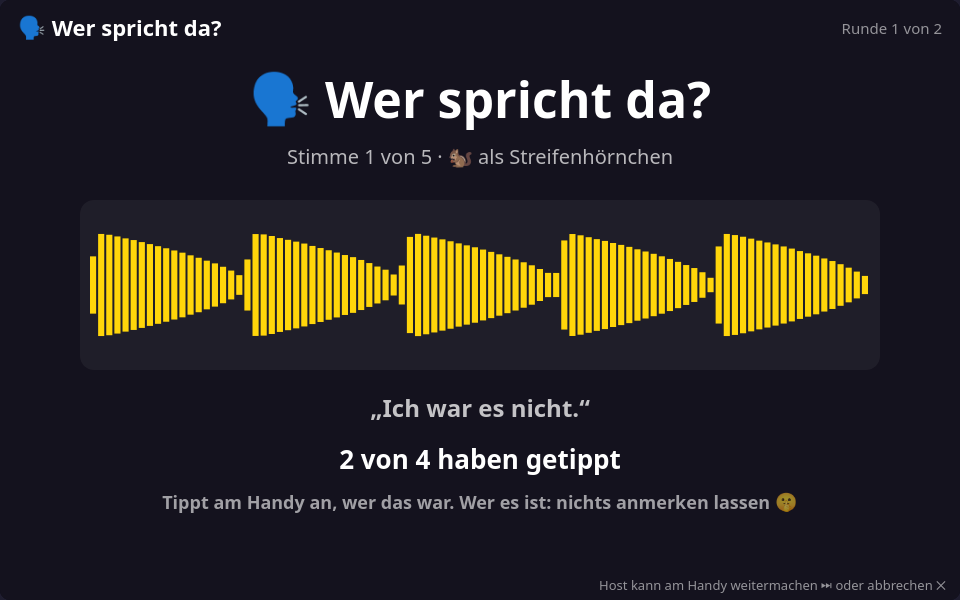

# 🗣️ Wer spricht da? — design notes

Everybody says the same sentence into their phone. The TV plays the voices back distorted,
as a chipmunk or as a monster, and everybody taps who it was. 3+ phones.

This file is the contract between the modules. If you change a shape or a rule here,
change it in the code and in the tests too.

## Files

| File | Loaded by | Owns |
|---|---|---|
| `public/core/mic.js` | controller | recording: live microphone or the phone's recorder app (see [Rückwärtsgang](RUECKWAERTS.md#how-a-voice-gets-to-the-tv)) |
| `public/core/voiceclip.js` | screen + controller | cutting, levelling, packing a recording → `window.VoiceClip` |
| `public/games/werspricht/meta.js` | screen + controller | key, label, settings |
| `public/games/werspricht/sentences.js` | screen | 32 short sentences |
| `public/games/werspricht/rules.js` | screen (+ Node tests) | recording, order of voices, guesses, points → `window.WsRules` |
| `public/games/werspricht/screen.js` | screen | keeps the recordings, plays them at another speed, phone protocol, stage |
| `public/games/werspricht/controller.js` | controller | sentence and record buttons, name buttons |
| `public/dev-werspricht.html` | — | TV harness with bots; `?phone=1` adds the real phone UI |
| `test-werspricht.js`, `test-werspricht-flow.js` | Node, Node/JSDOM | rules; shell + phones end to end |

## A round

| Phase | TV | Phones |
|---|---|---|
| `rec` | the sentence, a clock, a tile per player | everybody records, all at once, 45 s. A second recording replaces the first; 2 s after the last player has delivered it goes on |
| `guess` | "Wer spricht da?", the voice as a wave, how many have tapped | the owner: "Das bist du, nichts anmerken lassen". Everybody else: a button per voice of the round except their own; the tap can be changed |
| `reveal` | who it was, who recognised them, who fell for whom, and the real voice | right or wrong; the owner hears how many were fooled |

The voices come in a shuffled order. `guess` ends when everybody who may guess has tapped,
20 s after the voice has played, or when the host resolves it. The TV shows only a count
of taps, not who has tapped: the one who does not tap is the owner. A round with fewer
than two recordings is skipped.

**Distortion** is nothing but playback speed: 1.55× (higher and faster, 🐿️) or 0.68× (lower
and slower, 👹). The setting chooses one of them or a random one per voice.

**Points** (a setting, on by default): one for each right guess, and one for the owner per
player they fooled. So disguising your voice pays. Without points the reveal still says
who was right; nobody wins.

Who leaves: their voice stays in the round and can still be the answer. A latecomer
guesses along at once and records from the next round on.

## Phone protocol

Phone → screen: `wsHello`; `wsClip {pcm}` (as in Rückwärtsgang: base64 of 16-bit samples at
16 kHz); `wsGuess {id}`; host only: `wsPlay` (play the voice again), `wsNext` (stop waiting /
resolve / next voice), `wsRestart`.

Screen → phone: `wsState {phase, round, rounds, wertung, host, …}`. In `rec`: `text`,
`canRec`, `done`, `left`, `count`, `of`. In `guess`: `i`, `n`, `mine`, `high`, `options`
(`[{id, name}]`), `guessed`, `count`, `of`, `busyMs`. In `reveal`: `mine`, `by`, `byName`,
`right` (null for the owner and for who did not guess), `fooled`, `caught`. At the end:
`score`, `won`.

## Tunables

Top of `rules.js`: recording and guessing times, the two playback speeds.

## Untested

Real voices. Whether a chipmunk at 1.55× is hard enough to recognise, and whether the
recordings of four people speaking at once in one room stay apart, only a round with
people can tell.
